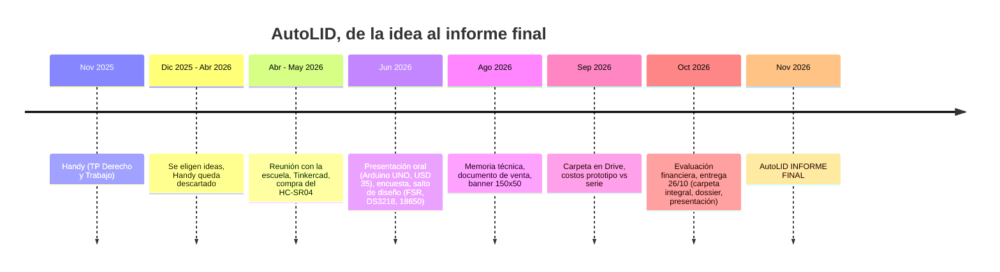

# Historia del proyecto

> [!summary] De Handy a AutoLID en un año
> El grupo arrancó con **Handy** (una prótesis-guante con herramientas, nov. 2025), la descartó y eligió **AutoLID** en abril de 2026. El proyecto pasó de un prototipo con Arduino UNO, ultrasonido y un servo común (junio) a un dossier completo con sensor de peso, batería, planta PYME y evaluación financiera (octubre-noviembre). El documento vigente es el [[Informe final - resumen|AutoLID INFORME FINAL]] (10/11/2026).

Fechas en hora argentina, tomadas de Drive. "Creado" = cuando apareció el archivo; varias versiones se crearon y no se volvieron a tocar. El detalle de cada archivo está en [[Archivos en Drive]].

## Etapa 0: antes de AutoLID (nov. 2025 - abr. 2026)
| Fecha | Qué pasó | Fuente |
|---|---|---|
| 26/11/2025 | **Handy**, TP de *Derecho y Trabajo* (Agustín: especificaciones técnicas; Luciano: marketing, diseño y redes). Ver [[Handy]]. | `Handy.pdf`, `Handy.png`, `Handy-Portada.png` |
| Dic 2025 - Abr 2026 | El grupo evalúa ideas y quedan tres: **Handy**, **AutoLid** y **ChairReach** (brazo que pasa al usuario de la silla de ruedas al auto). Handy se descarta por costo y complejidad. | `CARPETA DE CAMPO` |

## Etapa 1: arranque y primer prototipo (abr. - jun. 2026)
| Fecha | Qué pasó | Fuente |
|---|---|---|
| 14/04 | Reunión con el jefe de taller, la vicedirectora y el profesor de prácticas profesionalizantes: idea, funcionamiento, materiales y costos. La escuela ofrece una placa Arduino. | `CARPETA DE CAMPO` |
| 15/04 | Se crea la **CARPETA DE CAMPO** (bitácora; se editó hasta el 16/06). | Drive |
| 21/04 | Circuito simulado en **Tinkercad Circuits**: funciona en simulación. | `CARPETA DE CAMPO` |
| 05/05 | Acuerdo para usar un **Arduino UNO** de la escuela. Meta: terminar antes de la primera exposición de junio. | `CARPETA DE CAMPO` |
| 07/05 | `arduino_1.ino`: prueba de un relé por puerto serie (no es la lógica de AutoLID; se subió a la carpeta el 03/09). | Drive |
| 09/05 | Se compran protoboard, cables y el sensor ultrasónico **HC-SR04**. | `CARPETA DE CAMPO` |
| 04/06 | **Presentación oral**. Versión simple: Arduino UNO, HC-SR04, servo común, fuente externa. Materiales: **unos USD 35**. | `Presentación Oral – Proyecto AutoLID` |
| 16/06 | Se crea la **Encuesta AutoLID** (Google Forms, desde la cuenta agustincalderon5556; última edición 26/08). | Drive |
| 19/06 | Tres fotos de WhatsApp en "Cosas desde el celu" (*posiblemente* del prototipo; no las abrí). | Drive |

## Etapa 2: el salto de diseño (29/06/2026)
El mismo día aparecen tres documentos que ya describen **el AutoLID "grande"**:
- `Carpeta de Campo Formal`, `Carpeta de Campo Completa V2` y `Resumen: Proyecto AutoLID`.
- **Novedades respecto de junio:** sensor de peso **FSR 402** bajo el asiento (anti-cierre), servo **DS3218 de 20 kg·cm**, batería **18650** con 30-60 días de autonomía, gabinete **IP65**, adaptador **PETG** y carcasa de **acero inoxidable**. También aparecen los **tres públicos** (movilidad reducida, hogares, industria/laboratorios) y la **libertad para operar** (patentes vencidas).

## Etapa 3: memoria técnica y venta (ago. - sep. 2026)
| Fecha | Qué pasó | Fuente |
|---|---|---|
| 04/08 | `Memoria Técnica y Dossier Completo` y su **V2** (20 min después). | Drive |
| 11/08 | `Proyecto AutoLID`: documento informativo sobre **diseño y venta**. | Drive |
| 25-26/08 | PDFs para imprimir: `autolid_50x150cm_impresion.pdf` (**banner 150×50 cm**) y `autolid_diseno_3_impresion.pdf`. Están en la PC Windows, **no en Drive**. | Historial de Gemini |
| 03/09 | Se crea la carpeta **AutoLID** en Drive. | Drive |
| 10/09 | `Carpeta de Campo` (técnica) y `Costos y Rentabilidad Proyecto AutoLID`: separan **prototipo** y **producto en serie**, con PCB propia y compras por mayor. | Drive |

## Etapa 4: entrega del 26/10 (oct. 2026)
| Fecha | Qué pasó | Fuente |
|---|---|---|
| 19/10 | `evaluacion-financiera-autolid.pdf`: VAN +$51,41 M, TIR 62,47 %, IR 4,67, payback 1,98 años. | Drive |
| 20/10 | Registros exportados (`output.txt`, varios `.jsonl`) que mencionan AutoLID; se subieron el 27/10. No los revisé. | Drive |
| 26/10 | **Fecha de entrega.** Presentación `AutoLID` (12 diapositivas), `Carpeta de Campo Integral (EEST3 de Padua)` (11 capítulos) y dos `dossier-tecnico-autolid.pdf`. | Drive |
| 27/10 | `Carpeta de Campo Integral V2 (Edición Visual Mejorada)`. | Drive |

## Etapa 5: informe final (nov. 2026)
| Fecha | Qué pasó | Fuente |
|---|---|---|
| 10/11 | **AutoLID INFORME FINAL**: creado 11:10, última edición 11:34. A las 13:06 se le crea un acceso directo en la raíz de Drive. Es el documento principal. | Drive |

## Cómo cambió el diseño
| Aspecto | Primera versión | Versión final |
|---|---|---|
| Placa | Arduino UNO de la escuela | Arduino Nano (ATmega328P) en PCB propia |
| Detección | Ideas probadas: placas de contacto en la puerta → reed switch (MC-38 / RC-33) → infrarrojo HW-201 | **HC-SR04** (< 60 cm durante 3 s) + **FSR 402** bajo el asiento |
| Motor | Servo común (micro SG90/MG90S para la maqueta) | **DS3218 20 kg·cm** a 3 RPM; a futuro, paso a paso NEMA 17 |
| Energía | Fuente externa | 2 celdas 18650 (6000 mAh), TP4056 + MT3608, 30-60 días |
| Mecánica | **Doble caja + vástago telescópico** de aluminio con goma, control bajo la mochila | **Caja única ≤ 15 cm** + pletina directa + adaptador PETG para bisagras de 38-43 mm |
| Costo | ~USD 35 en materiales | $185.800 ARS el prototipo; $138.000 ARS por unidad en lote de 100 |
| Alcance | Proyecto escolar | Plan PYME: planta de 60 m², mercado AMBA, evaluación a 5 años |

> [!note] El sensor y la mecánica no tienen fecha propia
> El paso de doble caja a caja única y las pruebas de sensores solo aparecen contados en la Carpeta de Campo Integral (26/10), sin fecha. Los componentes finales (FSR, DS3218, 18650) ya figuran el 29/06; cuándo cambió la mecánica no se puede saber por los archivos.

## Relacionado
[[00 AutoLID]] · [[Archivos en Drive]] · [[Informe final - resumen]] · [[Handy]]
