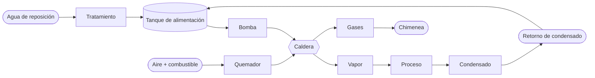

# Caldera

> [!summary] Función
> Toma agua y, con una **fuente de calor** (combustión o electricidad), la convierte en **vapor** o la lleva a una temperatura útil. A diferencia del [[Intercambiador de calor]], **genera** el calor. Trabaja con temperatura **y** presión, así que es, a la vez, un [[Recipiente a presión]] y uno de los equipos **más ligados a la seguridad**.

![[caldera.png|560]]

## Tipos
| | Pirotubular | Acuotubular |
|---|---|---|
| Por los tubos pasan | Gases calientes (el agua está alrededor) | Agua y vapor (los gases están alrededor) |
| Presión y capacidad | Baja a media | Alta |
| Respuesta | Gran volumen de agua: aguanta picos, pero arranca lento | Responde rápido |
| Uso | Alimentaria, lavaderos, hospitales | Centrales y grandes procesos |

## Sistema completo

## Variables y seguridad
- **Nivel:** control de nivel (operativo) y **corte por bajo nivel** (seguridad, independiente). Si los tubos quedan sin agua, se sobrecalientan.
- **Presión:** el control de presión gobierna el quemador; la **válvula de seguridad** descarga ante una sobrepresión.
- **Llama:** la **detección de llama** corta el combustible si se apaga (para que no se acumule gas sin quemar).
- **Temperatura de chimenea:** indica la eficiencia. Si sube, el calor no está pasando al agua.

> **Un control normal no es un dispositivo de seguridad.** Uno mantiene la operación; el otro actúa cuando el primero falla.

## Agua de alimentación
- **Dureza:** forma **incrustaciones**, que aíslan, hacen subir el consumo y **sobrecalientan el metal**.
- **Corrosión:** por oxígeno o por pH.
- **Retorno de condensado:** es agua caliente y ya tratada. Si se pierde, entra más reposición, más sales y hace falta más purga.
- **Purga:** saca los sólidos concentrados. **Purgar de más tira energía y químicos.** Lo correcto es purgar según la conductividad.

## Relacionado
[[Intercambiador de calor]] · [[Recipiente a presión]] · [[Bomba]] · [[Sistema de calentamiento de agua]] · [[TP9 Calderas industriales]]
