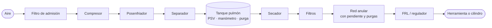

# Sistema de aire comprimido

> [!summary] El sistema que el grupo eligió en los TP1, TP2 y TP3
> El aire ambiente se comprime, se enfría, se le saca el agua, se almacena, se trata y se distribuye hasta las herramientas. La variable principal es la **presión**. Además es el sistema de la empaquetadora de Panadería Pilar ([[TP4 Cañerías y válvulas|TP4]]) y el tema del [[TP8 Compresores de aire|TP8]].

![[sistema_aire.png|700]]

## Cómo creció el mismo sistema a lo largo del año
| TP | Lo que se agregó |
|---|---|
| [[TP1 Diagramas de proceso\|TP1]] | Esquema básico: aire → compresor → tanque pulmón → línea → herramienta |
| [[TP2 Equipos de un proceso\|TP2]] | La función de cada equipo en relación con el anterior y el siguiente, y qué pasa si uno falla |
| [[TP3 Variables de proceso\|TP3]] | La **presión** como variable principal, manómetros M1 (tanque) y M2 (punto de uso), problemas por presión baja, alta o variable |
| [[TP4 Cañerías y válvulas\|TP4]] | Trazado real: pendiente del 1–2 %, piernas de purga, FRL, check, separador agua-aceite |
| [[TP5 Tanques y recipientes a presión\|TP5]] | El tanque pulmón como **recipiente a presión**: PSV, cabezales, inspección |
| [[TP8 Compresores de aire\|TP8]] | El sistema completo: posenfriador, secador, filtros, control, fugas, eficiencia |

## Esquema completo

## Qué hace cada equipo
- **[[Compresor]]:** el **único** equipo que aporta energía al aire.
- **Posenfriador y separador:** bajan la temperatura y sacan el agua condensada.
- **Tanque pulmón:** almacena, amortigua las pulsaciones y estabiliza la presión. **No produce aire.** Es un [[Recipiente a presión]].
- **Secador** (frigorífico o de adsorción) y **filtros:** dejan el aire con la calidad que pide el uso (ISO 8573-1).
- **Red:** conduce. Su diseño (diámetro, trazado, purgas) define cuánta presión llega al consumo.
- **Regulador o [[Unidad FRL|FRL]]:** ajusta la presión de trabajo en el punto de uso.
- **Consumo:** convierte la presión en trabajo mecánico.

## Fallas y diagnóstico
| Síntoma | Qué mirar antes de comprar otro compresor |
|---|---|
| Herramientas sin fuerza | Presión en el punto de uso (M2) comparada con la del tanque (M1); fugas; filtros y FRL; regulador |
| Baja presión solo lejos | Diámetro, red radial larga, fugas, consumos nuevos al final; pasar a una red anular |
| Agua en la red | Posenfriador, separador, purgas, punto de rocío del secador |
| Más energía sin más producción | Fugas (ultrasonido), presión de consigna, ΔP de los filtros, horas en vacío, usos indebidos |

## Seguridad
El aire almacena energía. Un tanque es un recipiente a presión, con su PSV y sus inspecciones. **Nunca** usar el aire sobre el cuerpo. Para el mantenimiento, aislar y descargar la presión.

## Relacionado
[[Compresor]] · [[Recipiente a presión]] · [[Unidad FRL]] · [[Pérdidas de carga]] · [[Variables de proceso]]
