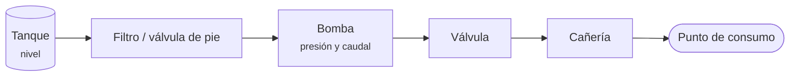

# Sistema de bombeo de agua

> [!summary] Esquema del apunte
> **Tanque → bomba → cañería → válvula → punto de consumo.** El tanque almacena, la [[Bomba]] entrega energía, la cañería conduce y la válvula regula o corta.

## Variables
- **Nivel del tanque:** si baja demasiado, aparecen vórtices o cavitación y la bomba trabaja en vacío.
- **Presión** de aspiración y de descarga.
- **Caudal** entregado.
- **Estado de la bomba:** vibración, temperatura, amperes.

## Lo que hay que recordar de los TP
- **[[TP3 Variables de proceso|TP3]]:** si la bomba no da el servicio, **no alcanza con mirar la bomba**. Hay que revisar el nivel, las válvulas de aspiración e impulsión, las cañerías y las presiones.
- **[[TP5 Tanques y recipientes a presión|TP5]]:** una bomba irregular con el tanque bajo es un problema de **nivel**, no de la bomba.
- **[[TP7 Bombas industriales|TP7]]:**
  - el caudal sale del **punto de funcionamiento**, que depende de la bomba **y** de la instalación;
  - ruido de grava + nivel bajo + filtro sucio = **cavitación** (NPSHA < NPSHR).

## Relacionado
[[Bomba]] · [[Tanque]] · [[Válvulas]] · [[Pérdidas de carga]]
