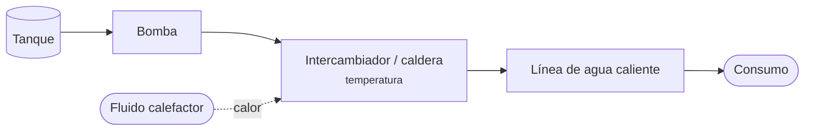

# Sistema de calentamiento de agua

> [!summary] Esquema del apunte
> **Tanque → bomba → intercambiador o calentador → línea de agua caliente → consumo.** Además de transportar el fluido, **cambia su energía**: la variable central es la **temperatura**.

## Lo que hay que recordar de los TP
- **[[TP3 Variables de proceso|TP3]]:**
  - si el agua llega pero "no da el resultado", la variable es la **temperatura** a la salida del equipo térmico;
  - causas posibles: poca fuente de calor, incrustaciones o **demasiado caudal** (falta tiempo de contacto);
  - en este sistema la presión es secundaria.
- **[[TP6 Intercambiadores de calor|TP6]]:**
  - se miden las 4 temperaturas, el caudal y la ΔP;
  - temperatura que baja + ΔP que sube = **fouling**.
- **[[TP9 Calderas industriales|TP9]]:** si el calor lo genera una **[[Caldera]]**, se suman la combustión, el tratamiento del agua y la seguridad (nivel, presión, llama).

## Relacionado
[[Intercambiador de calor]] · [[Caldera]] · [[Bomba]] · [[Variables de proceso]]
