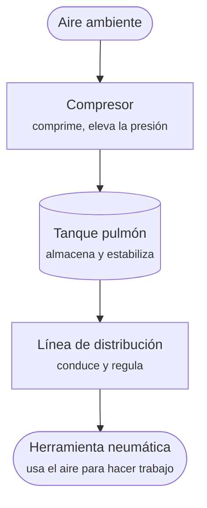

# TP2 · Equipos principales de un proceso

> [!abstract] En una línea
> Pasar de "qué equipos hay" a **"qué hace cada equipo en relación con el anterior y el siguiente"**. Un proceso es una *organización de funciones*: unos almacenan, otros impulsan, regulan, contienen presión o transfieren calor.

Anterior: [[TP1 Diagramas de proceso]] · Siguiente: [[TP3 Variables de proceso]]

## Consigna (resumida)
- **Parte A – Comprensión:** qué es un equipo de proceso y por qué no se analiza aislado; por qué no todos hacen lo mismo; comparar tanque y recipiente a presión (1 semejanza y 2 diferencias); comparar bomba y compresor; por qué una válvula no reemplaza a una bomba; intercambiador frente a caldera; qué equipo está más ligado a la seguridad.
- **Parte B – Relación con el TP1:** tomar el sistema del TP1, listar sus equipos, explicar la función de cada uno respecto del anterior y del siguiente, decir cuál entrega energía y cuál almacena o regula, qué variable controlar y dónde, y qué pasa si un equipo falla.
- **Parte C – Aplicación:** volver a dibujar el sistema con la función escrita al lado de cada equipo y redactar la explicación completa.

## Teoría clave del apunte
El apunte del profe (`Equipos principales de un proceso y función de cada uno 26.docx`) relaciona cuatro ideas: **equipo, fluido, función y variable**.

| Equipo | Función | Fluido | Variable típica |
|---|---|---|---|
| [[Tanque]] | Almacena, reserva, amortigua | Líquidos | Nivel |
| [[Bomba]] | Impulsa: energía mecánica → energía hidráulica | Líquidos | Presión y caudal |
| [[Compresor]] | Comprime: baja el volumen y sube la presión | Gases (aire) | Presión |
| [[Válvulas\|Válvula]] | Abre, cierra, regula o desvía (**no** aporta energía) | Cualquiera | Caudal y presión |
| [[Intercambiador de calor]] | Transfiere calor entre dos fluidos sin mezclarlos | Líquidos y gases | Temperatura |
| [[Caldera]] | Genera vapor o agua caliente con un aporte de calor | Agua y vapor | Temperatura y presión |
| [[Recipiente a presión]] | Contiene un fluido a presión distinta de la atmosférica | Gases y vapor | Presión |

- **Los equipos no se ponen al azar:** si se altera la secuencia (por ejemplo, el tanque pulmón *antes* del compresor), el sistema deja de cumplir su función.
- **Se parecen, pero no hacen lo mismo:** bomba y compresor; tanque y recipiente a presión; intercambiador y caldera.
- **Seguridad:** los equipos más críticos son el recipiente a presión y la caldera, por la energía almacenada, la presión y la temperatura.
- **Falla:** comprender un equipo es también saber qué pasa si deja de funcionar.

## Nuestra resolución
### Parte A
- **Tanque y recipiente a presión.** Se parecen en que los dos contienen fluidos. Se diferencian en la presión (atmosférica en el tanque, distinta de la atmosférica en el recipiente) y en las exigencias de diseño y seguridad. Ejemplo: el tanque de agua de un edificio es un tanque; el tanque pulmón del aire comprimido es un recipiente a presión.
- **Bomba y compresor.** La bomba impulsa líquidos, que son incompresibles. El compresor comprime gases, que son compresibles. No se pueden intercambiar.
- **Válvula y bomba.** La válvula controla el paso y no aporta energía. La bomba transforma energía mecánica en hidráulica. La válvula solo regula lo que la bomba ya puso en movimiento.
- **Intercambiador y caldera.** El intercambiador *redistribuye* calor entre fluidos que ya existen; la caldera *genera* calor (por combustión o electricidad) y produce vapor.
- **Equipo más ligado a la seguridad:** el **recipiente a presión**, seguido de la caldera. Necesita normas (ASME, IRAM), verificaciones periódicas, válvulas de seguridad y personal capacitado.

### Partes B y C · Sistema de aire comprimido
| Equipo | Función propia | Relación con el sistema |
|---|---|---|
| [[Compresor]] | Comprime el aire y eleva su presión | Recibe aire ambiente y lo entrega al tanque pulmón |
| Tanque pulmón | Almacena y estabiliza la presión | Recibe del compresor y alimenta la línea en forma constante |
| Línea de distribución | Conduce, con válvulas que aíslan y regulan | Lleva el aire del tanque a cada punto de uso |
| Herramienta neumática | Convierte la presión en trabajo mecánico | Consume el aire |

- **Entrega energía:** el compresor. **Almacena:** el tanque pulmón. **Regula y conduce:** la línea con sus válvulas.
- **Variable clave:** la **presión**, que conviene medir a la **salida del tanque pulmón**, antes de la línea, porque refleja lo que llega a los consumos. La temperatura es secundaria: el compresor genera calor.
- **Si falla un equipo:**
  - el compresor → se para todo (la falla más crítica);
  - el tanque → no hay reserva y las pulsaciones del compresor llegan a las herramientas;
  - una fuga en la línea → baja la presión y el compresor trabaja de más;
  - una herramienta → solo se pierde ese punto de consumo.

> [!tip] Exposición
> Además del documento, en Drive hay una presentación `TP N°2.pptx` (24/04/2026) para exponer.

## Archivos en Drive
- Consigna: `Equipos principales de un proceso y función de cada uno(tp2).docx`
- Teoría: `Equipos principales de un proceso y función de cada uno 26.docx`
- Entrega: `TP2_Parte_A` y `TP2_Partes_BC` (Google Docs), `TP N°2.pptx`

## Ver también
[[Tanque]] · [[Bomba]] · [[Compresor]] · [[Válvulas]] · [[Intercambiador de calor]] · [[Caldera]] · [[Recipiente a presión]] · [[00 Inicio]]
