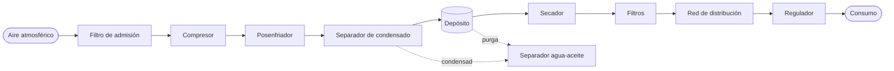

# TP8 · Compresores de aire y sistemas de aire comprimido

> [!abstract] En una línea
> No se estudia "el compresor" sino **el sistema de aire comprimido**: aspiración → compresión → enfriamiento → separación de condensado → depósito → secado y filtrado → red → regulación → consumo. **Producir más presión de la necesaria cuesta energía**, y **un compresor más grande no arregla una red con fugas**.

Anterior: [[TP7 Bombas industriales]] · Siguiente: [[TP9 Calderas industriales]]

## Consigna (resumida)
**Cuestionario. Parte 1 – Presión, tecnologías y funcionamiento:**
1. Demanda intermitente frente a demanda continua: ¿el mismo compresor?
2. "Bomba y compresor son prácticamente iguales."
3. Para qué sirve el **interenfriador** entre dos etapas.
4. El mismo caudal nominal medido con distintas condiciones de referencia.
5. Pistón o tornillo para un consumo continuo y grande: qué analizar.
6. Consecuencias de la temperatura de compresión. La refrigeración no es un accesorio.
7. Compresor lubricado y un proceso que no admite aceite.
8. Comprar "el de mayor presión para tener margen".

**Cuestionario. Parte 2 – Tratamiento, distribución, eficiencia y diagnóstico:**
1. Gotas de agua en la red aunque no se aspire agua líquida.
2. Corrosión y fallas en las herramientas con el resto bien dimensionado.
3. Un filtro muy sucio que todavía retiene.
4. Baja presión solo en el extremo de la planta: al menos 4 causas.
5. Muchas fugas pequeñas.
6. Un solo equipo necesita aire muy seco.
7. Un compresor más grande y la presión sigue baja.
8. Sube el consumo eléctrico sin que suba la producción: orden de comprobaciones.

**Investigación grupal:**
- comparar **pistón, tornillo y centrífugo**;
- esquema del **sistema completo**, justificando el orden;
- tratamiento del aire (**punto de rocío**, secador frigorífico o de adsorción);
- **potencia específica**;
- control **start-stop / carga-descarga / velocidad variable** y el papel del depósito;
- análisis de **fugas** y pérdidas de presión.

## Teoría clave del apunte
- **[[Compresor]]:** aumenta la presión de un **gas** con trabajo mecánico. Los gases son compresibles y los líquidos no: por eso **no** es una bomba.
- **Familias:**
  - **desplazamiento positivo**: pistón, tornillo, paletas, scroll;
  - **dinámicos**: centrífugo, con impulsor y difusor.
- **Pistón:**
  - admisión, compresión y descarga con válvulas;
  - entrega **pulsante**: el depósito la amortigua;
  - sirve para consumos chicos o **intermitentes**.
- **Multietapa con interenfriamiento:** se enfría entre etapas. Baja el trabajo y las temperaturas finales; no es "dos compresores en fila".
- **Tornillo:**
  - dos rotores; entrega **continua**; para demanda estable e industrial;
  - puede ser **lubricado** (el aceite sella, lubrica y enfría, y después se separa) u **oil-free**, que **no** garantiza aire puro.
- **Centrífugo:** para **grandes caudales** continuos.
- **Caudal:**
  - el volumen de un gas depende de p y T, así que hay que saber las **condiciones de referencia**;
  - **FAD** (*free air delivery*); ensayo según **ISO 1217**.
- **Presión:** se busca la **necesaria en el punto de consumo**, no la máxima. Más presión significa más energía y más fugas.
- **Relación de compresión** = p_abs descarga / p_abs aspiración.
- **Temperatura:**
  - comprimir calienta;
  - afecta el aceite, los sellos y la humedad;
  - la refrigeración (por aire, agua o aceite) es parte del sistema.
- **Posenfriador:** al enfriar condensa agua, y por eso hace falta **separar y drenar**.
- **Humedad y punto de rocío a presión:**
  - el compresor aspira el vapor de agua del ambiente y lo concentra;
  - al enfriarse, se vuelve líquido.
- **Secadores:**
  - **frigorífico**: aire de planta;
  - **adsorción**: punto de rocío muy bajo, más caro.
- **Filtros:**
  - retienen partículas, aerosoles de aceite y agua;
  - un filtro sucio empeora la **calidad** y además sube la **ΔP** y la **energía**.
- **Calidad del aire:** clases de pureza **ISO 8573-1** (partículas, agua y aceite). Se especifica según el uso.
- **Depósito:**
  - almacena, amortigua y estabiliza;
  - **no produce aire**;
  - es un **[[Recipiente a presión]]**: lleva drenaje de condensado y **válvula de seguridad**, que no es para regular.
- **Control:**
  - presostato con **start-stop** (equipos chicos);
  - **carga-descarga** (en vacío igual consume);
  - **variador de velocidad** (demanda variable, aunque no siempre es lo mejor);
  - secuenciamiento si hay varios compresores.
- **Costo:** gran parte de la energía termina en **calor**, que se puede **recuperar** (enlace con [[Intercambiador de calor|intercambiadores]]).
- **Fugas:**
  - en uniones, acoples rápidos, mangueras, reguladores y drenajes;
  - se detectan con **ultrasonido**;
  - "Instalar un compresor mayor no compensa las fugas."
- **Caída de presión:** no se arregla **subiendo la presión del compresor** (más energía y más fugas, y la causa sigue ahí). Conviene una red **anular**, con buen diámetro y drenajes.
- **Regulador:** reduce y mantiene la presión, pero **no puede crear presión**.
- **Seguridad:** el aire almacena energía. Nunca apuntarlo al cuerpo, y mantener sin presión y aislado.
- **Potencia específica:** kW por m³/min en condiciones de referencia. Se compara así, no por la potencia del motor.

## Resolución (guía de estudio)
> [!note] Estado de la entrega
> En Drive no hay un documento de respuestas del grupo para este TP; solo una **presentación interactiva en Google Sites** ("Presentación Interactiva - Compresores y Sistemas de Aire Comprimido", 10/11/2026), que las herramientas no pueden leer. Las respuestas que siguen salen del apunte del profe.

### Parte 1
| # | Idea clave de la respuesta |
|---|---|
| 1 | La demanda **intermitente** va con un pistón y control start-stop más un depósito. La **continua**, con un tornillo con carga-descarga o variador. Se elige por el **perfil de demanda** |
| 2 | Falso: la bomba mueve **líquidos incompresibles**; el compresor reduce el **volumen de un gas compresible**, que además se calienta y condensa agua |
| 3 | El interenfriador **baja la temperatura entre etapas**: hay que comprimir menos volumen, se gasta menos trabajo, las temperaturas finales bajan y sufre menos el aceite |
| 4 | El volumen de un gas depende de p y T. Sin las mismas **condiciones de referencia** (FAD, ISO 1217) la comparación no vale |
| 5 | Hay que mirar continuidad, caudal, presión, perfil de demanda, refrigeración, ruido, mantenimiento, **potencia específica** y calidad de aire |
| 6 | La temperatura degrada el aceite y los sellos, carga humedad en el aire, puede ser peligrosa y baja el rendimiento. La refrigeración es una **condición de funcionamiento** |
| 7 | Antes de cambiar el compresor, revisar el **separador de aceite**, los **filtros coalescentes** y de carbón activado, la clase ISO 8573-1 que pide el proceso, el estado de la red y el tratamiento en el punto de uso |
| 8 | Más presión significa **más energía, más fugas y más desgaste**. Hay que generar la presión necesaria **más** las pérdidas reales de la red |

### Parte 2
| # | Idea clave de la respuesta |
|---|---|
| 1 | El compresor aspira **vapor** de agua; al enfriarse por debajo del **punto de rocío** se condensa en la red |
| 2 | Revisar el **tratamiento**: drenajes y purgas automáticas, el secador (punto de rocío alcanzado) y los filtros (ΔP). Variables: punto de rocío a presión, ΔP de los filtros, temperatura de entrada al secador, contenido de aceite |
| 3 | Si todavía retiene, igual **sube la ΔP**: llega menos presión, el compresor trabaja más y puede romperse o dejar pasar suciedad |
| 4 | Diámetro chico o red radial muy larga; **fugas**; filtros o reguladores saturados; consumo agregado al final de la línea; válvulas entrecerradas; agua acumulada. Solución: red anular y medir presiones a lo largo |
| 5 | Las fugas **suman** caudal perdido las 24 h: el compresor produce aire que nadie usa. Más energía y menos presión disponible |
| 6 | Conviene un secado **puntual** (por ejemplo, adsorción solo para ese equipo) y frigorífico para el resto. Secar todo a ese nivel es caro en inversión y energía |
| 7 | Si el problema es la **red** (diámetro, fugas, filtros, ΔP), producir más no lo corrige |
| 8 | Recorrer en orden **producción** (horas en carga y en vacío, presión de consigna, potencia específica) → **tratamiento** (ΔP de filtros y secador) → **almacenamiento** (purgas, volumen útil, ciclos) → **distribución** (fugas con ultrasonido y presión en los extremos) → **consumo** (usos indebidos, sopletes, equipos nuevos o abandonados) |

## Archivos en Drive
- Teoría y cuestionario: `Compresores de aire_26.docx`
- Consigna de la investigación: `Trab Inv Grupalcompresores_26.docx`
- Presentación del grupo: `Presentación Interactiva - Compresores y Sistemas de Aire Comprimido` (Google Sites)
- **Entrega final (13/11/2026)**, en la carpeta *Charrute*:
  - `TP N° 8 - Compresores de aire y sistemas de aire comprimido`: Google Docs con la organización del grupo, los dos cuestionarios, la investigación con fichas CAGI reales y la guía de exposición. También está la copia en PDF.
  - `TP N° 8 - Compresores de aire (presentación)`: Google Slides de 13 diapositivas.
- **Reparto del grupo:** tres parejas, una por tramo del sistema (producción, tratamiento, y distribución y control).

## Ver también
[[Compresor]] · [[Sistema de aire comprimido]] · [[Recipiente a presión]] · [[Válvulas]] · [[TP4 Cañerías y válvulas]] (planta Panadería Pilar) · [[00 Inicio]]
