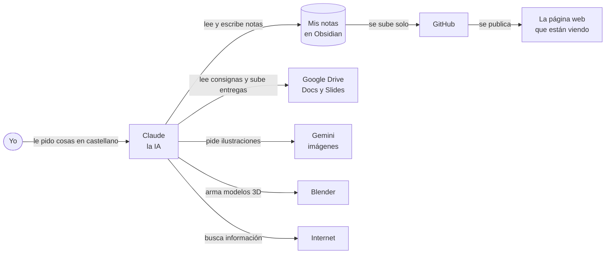

# Mi entorno en una imagen

Antes de entrar en detalle, este es el mapa completo. No hace falta entenderlo ahora: al terminar la guía, cada caja va a tener sentido.

## Las piezas, en una línea cada una

| Pieza | Qué es | Para qué la uso | Nivel |
|---|---|---|---|
| **Claude** | Una inteligencia artificial de la empresa Anthropic | Es el "ayudante": entiende lo que le pido y lo hace | 1 |
| **Proyectos y conectores** | Formas de darle a Claude mis archivos y mi Google Drive | Que lea las consignas del profe sin que yo copie y pegue | 2 |
| **Obsidian** | Un programa gratuito para tomar notas | Guardar todo lo que aprendo en notas conectadas entre sí | 3 |
| **Claude Code** | Claude trabajando *dentro* de mi compu, no solo en un chat | Que cree, ordene y corrija archivos por mí, con mi permiso | 4 |
| **Memoria** | Notas que Claude guarda sobre cómo trabajo | No tener que repetirle lo mismo cada vez ("escribí en castellano", "el vault está en tal carpeta") | 4 |
| **Skills** | "Recetas" guardadas que Claude sigue | Hacer siempre igual una tarea que repito | 4 |
| **GitHub + Quartz** | Un lugar en internet donde se guardan archivos, y un programa que los convierte en página web | Que mis notas se puedan leer desde cualquier celular | 5 |
| **Gemini** | La IA de Google, muy buena con imágenes | Ilustraciones para los TP | 5 |
| **Blender** | Programa gratuito de modelado 3D | Los visores 3D del torno y del Swift | 5 |

## La idea central

> [!important] Lo que cambia todo
> La IA sola es un chat que se olvida de todo al cerrar la ventana.
> **La IA conectada a mis archivos** se vuelve un compañero de trabajo que conoce mis apuntes, mis materias y mi forma de hacer las cosas.

Todo el entorno existe para eso: que Claude tenga **dónde leer** (mis notas, el Drive, internet) y **dónde escribir** (notas nuevas, documentos, la página web). Yo pongo el criterio, reviso y decido; Claude hace el trabajo repetitivo.
