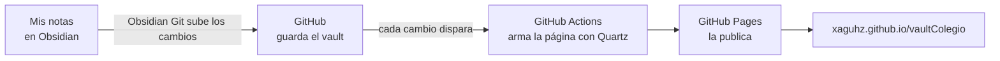

# 5.2 Publicar el vault como página

La página donde estás leyendo esto es un **vault de Obsidian publicado**. Cada vez que cambio una nota, en un par de minutos la página se actualiza sola. Así funciona, y así se puede armar.

## Las piezas



| Pieza | Qué es | Precio |
|---|---|---|
| **Git** | Programa que guarda el **historial** de cambios de una carpeta: se puede volver a cualquier versión anterior | Gratis |
| **GitHub** | Página donde se guardan carpetas con Git (llamadas *repositorios*) | Gratis |
| **Quartz** | Programa que convierte un vault de Obsidian en una página web, con links, grafo y buscador | Gratis |
| **GitHub Actions + Pages** | Un "robot" de GitHub que arma la página con Quartz y la publica en cada cambio | Gratis para repositorios públicos |
| **Obsidian Git** | Plugin que sube los cambios a GitHub solo, cada 10 minutos | Gratis |

> [!danger] Público quiere decir público
> El repositorio y la página los puede ver **cualquiera**, y Google los indexa. Nunca publiques datos de alumnos, notas, contraseñas ni material con derechos de autor (manuales o libros copiados). Yo, por ejemplo, el manual de taller del Swift lo tengo **solo en mi compu**: en el vault público van notas con palabras propias.

## Cómo lo armé
**No lo armé a mano: lo configuró Claude Code.** Yo le dije qué quería y fui aprobando los pasos. Antes tenía el vault sincronizado con Syncthing y quería verlo como Obsidian desde cualquier lado. Elegimos repositorio público con GitHub Pages, página de solo lectura y el plugin Obsidian Git para subir los cambios.

## Hacerlo con tu vault

### Lo que hace falta antes
1. Una **cuenta de GitHub**: [github.com](https://github.com) → **Sign up**. Elegí un nombre de usuario corto: va a ser parte de la dirección (`tu-usuario.github.io`).
2. **Git** instalado ([git-scm.com](https://git-scm.com), opciones por defecto). Ver [[4.2 Instalar la app y abrir Code]].
3. Claude Code funcionando en la carpeta del vault.

### El pedido
```
Quiero publicar este vault de Obsidian como página web gratuita, que se actualice sola
cada vez que cambio algo. Usá GitHub Pages y Quartz. Mi usuario de GitHub es [USUARIO].
Guiame paso a paso: decime qué tengo que hacer yo (iniciar sesión, aprobar cosas)
y qué hacés vos. Antes de subir nada, revisá que no haya datos personales
ni archivos que no deberían ser públicos, y armá un .gitignore para lo que quede afuera.
Después instalame el plugin Obsidian Git para que suba los cambios solo.
```

En algún momento Claude te va a pedir que **inicies sesión en GitHub** (se abre el navegador). **Eso lo hacés vos**: Claude nunca tiene que ver ni escribir tu contraseña.

### Cuidados que aprendí
- **Links sin carpeta**: `[[Nombre de la nota]]`, no `[[Carpeta/Nombre de la nota]]`; si no, en la página dan 404 ([[3.4 Links, grafo y Canvas]]).
- **Esperar unos minutos**: GitHub tarda en armar la página, y además guarda una copia en caché. Si un cambio no aparece, recargá con `Ctrl + Shift + R`.
- **Revisar los links** de vez en cuando: *"recorré la página publicada y decime si hay links rotos"*.

## La alternativa paga
**Obsidian Publish** (USD 8 o 10 por mes) hace todo esto con un botón, sin GitHub. Para quien no quiere tocar nada técnico, es más simple.

## Para practicar
Creá tu cuenta de GitHub. Si te animás, publicá un vault **de prueba** (no el de tu materia) con el pedido de arriba.
