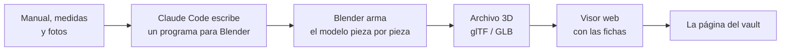

# 5.4 Modelos 3D con Blender

Es lo más llamativo de mi entorno: [el despiece 3D del torno](https://xaguhz.github.io/vaultColegio/vaultTorno/3D/visor/index.html) y [el del Suzuki Swift](https://xaguhz.github.io/vaultColegio/vaultSuzuki/3D/visor/index.html). Se giran con el mouse, se toca una pieza y aparece su ficha (qué es, qué mantenimiento lleva), y se pueden separar los conjuntos.

## Cómo se hace



1. **Las fuentes**: el manual del fabricante (medidas, despiece, nombres de las piezas) y fotos reales.
2. **Blender**: un programa gratuito de modelado 3D ([blender.org](https://www.blender.org)). Claude no lo maneja con el mouse: **escribe un programa** que le dice a Blender "hacé un cilindro de tal medida acá, restale este agujero, pintalo de tal color", pieza por pieza. Blender lo ejecuta en segundo plano.
3. **El archivo 3D** (formato glTF) se exporta del Blender.
4. **El visor**: una página web que muestra el modelo, con botones, capas y fichas. También la escribió Claude.

También existe un **conector de Blender** (ver [[4.6 Skills y conectores]]) que deja a Claude mover cosas en el Blender abierto y **mirar** cómo va quedando, para corregir.

## En números

| | Torno TM300 | Suzuki Swift |
|---|---|---|
| Piezas | 59, en 10 conjuntos | 140, en 20 conjuntos y 6 capas |
| Fuentes | Manual en inglés del torno y del fabricante | Manual de taller, fotos del auto y referencias generadas con Gemini |
| Extras del visor | Modo animación con fichas flotantes | Rayos X, circuitos eléctricos, desmontaje animado |

> [!warning] No sale de una
> Un modelo así lleva **muchas vueltas**: Claude arma una versión, la miro, le marco lo que está mal (*"el escape va adelante, no atrás"*, *"el auto es de caja manual"*) y corrige. El del Swift lo fuimos mejorando a lo largo de varios días, con fotos y con el manual de taller.

## Para un profe: empezar chico
No hace falta Blender para empezar. En el **chat** de Claude (nivel 2) se puede pedir un modelo simple que se ve en el panel de la derecha:

```
Armá un visor 3D interactivo de un engranaje recto de 20 dientes y uno de 40
engranando, que giren a la velocidad correcta según la relación de transmisión.
Que se pueda rotar con el mouse y que muestre la relación y las RPM de cada uno.
```

Para algo más grande (una máquina del taller con sus piezas y fichas), en **Claude Code**:

```
Quiero un despiece 3D de [máquina] para mi vault, como el del torno de
https://xaguhz.github.io/vaultColegio/vaultTorno/3D/visor/index.html.
Usá Blender (instalado en [ruta]) en segundo plano. Las medidas y los nombres de las piezas
están en Fuentes/[manual].pdf. Empezá por los conjuntos principales con formas simples;
después vamos agregando detalle con fotos.
```

## Para practicar
Pedile al chat de Claude el visor de engranajes de arriba (o uno de tu materia: un circuito, una molécula, un mecanismo) y probalo en el proyector.
