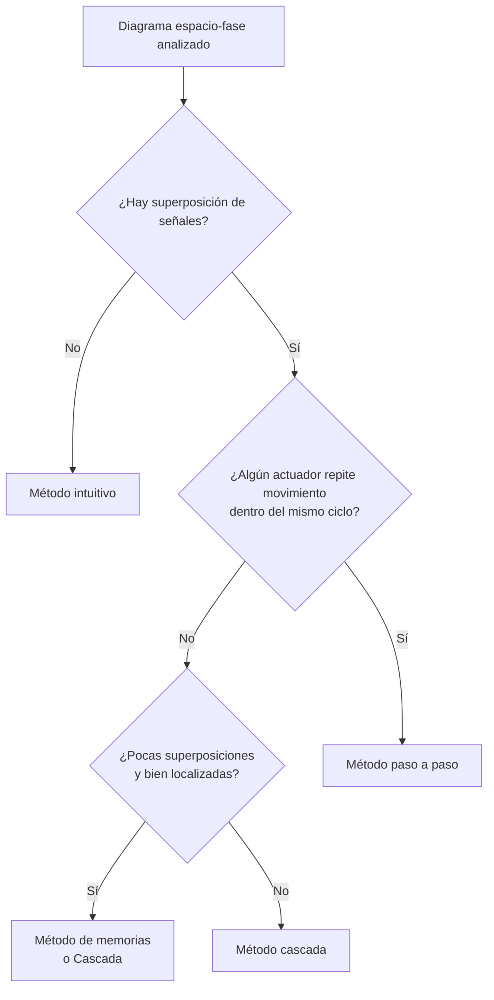

# Comparativa de métodos de resolución

Todos parten del mismo análisis: el [[Diagrama espacio-fase]] anotado. La diferencia está en **cómo se arma el circuito de mando** para que no aparezca [[Superposición de señales]].

| | [[Método intuitivo]] | [[Técnica Chopp]] | [[Método cascada]] | [[Método paso a paso]] | [[Método de memorias]] |
|---|---|---|---|---|---|
| **Otro nombre** | — | "chopeado" | Paso a paso por líneas, cascada eléctrica | — | Relé auxiliar de memoria |
| **Idea** | Cada emisor alimenta un relé y cada relé un cabezal, leyendo el diagrama | Pasar de válvula mono a biestable sin rehacer nada | Dividir la alimentación en **líneas** que se prenden de a una | Un **paso por fase**, y cada paso habilita al siguiente | Un relé auxiliar autorretenido **habilita o bloquea** los rodillos que molestan |
| **Relés de mando** | Uno por movimiento (más o menos) | Los mismos | Líneas − 1 | Uno por fase | Los del intuitivo + 1 auxiliar |
| **¿Resuelve superposición?** | No | No (aunque nunca alimenta los dos cabezales de la válvula que cambia) | Sí | Sí | Sí |
| **¿Movimientos repetidos en el ciclo?** | No | — | **No**: se mezclan las líneas | **Sí** | Caso por caso |
| **Tamaño del circuito** | Chico | Chico | Muy chico si hay pocas líneas | Grande pero repetitivo | Chico |
| **Particularidades** | Hay que detectar a mano dónde falla | Contacto NC del mismo relé que alimentaba al cabezal viejo | La última línea queda siempre energizada (consumo permanente) | Necesita el pulsador de marcha en paralelo con la autorretención del último paso para el primer arranque | Hay que habilitar el rodillo una fase antes de usarlo |
| **En PLC** | Directo ([[2020-09-03 Automatismo electroneumático en Ladder]]) | — | [[Cascada en Ladder]] | [[Paso a paso en Ladder]] (el más usado en la industria, según el profe) | — |
| **Videos** | [[2020-04-26 Electroneumática 1 actuador monoestable]] | [[2020-06-18 Técnica Chopp en FluidSIM]] | [[2021-05-21 Cascada con lógica cableada y superposición]] | [[2020-07-06 Método Paso a Paso - 1 actuador 4 fases]] | [[2025-05-04 Método de memorias - relé auxiliar]] |

## Cómo elegir

## Reglas clave para recordar
- **Cascada:** el cambio de línea va *justo antes* de que se repita el movimiento de un actuador que ya se movió en esa línea. Mínimo 2 líneas, máximo tantas como fases.
- **Paso a paso:** cada paso es igual: emisores + habilitación (relé anterior) + desconexión (relé siguiente) + autorretención.
- **Memorias:** contacto NC del auxiliar para el rodillo que tiene que actuar desde el arranque; contacto NA para el que no.
- **Chopp:** el cabezal nuevo se alimenta con un contacto NC del mismo relé.
