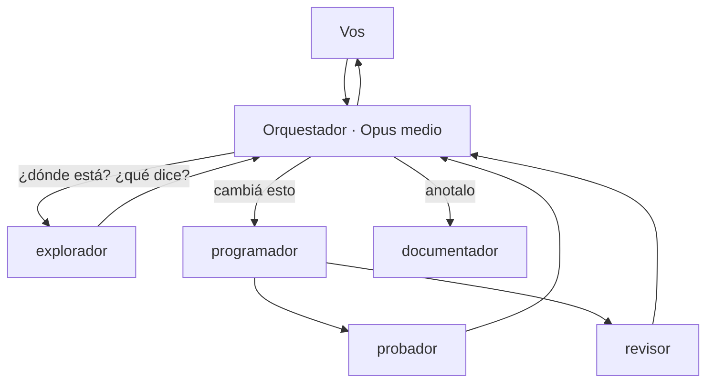

# Cómo funciona la oficina

## La idea
En vez de que un solo modelo grande haga todo (leer, programar, probar, escribir notas), se arma un equipo:

- **Orquestador: Claude Opus 5.5, esfuerzo medio.** Es la sesión con la que hablás. Entiende el pedido, hace el plan, reparte, junta los resultados, decide y te responde.
- **Cinco agentes: Claude Sonnet 5.5.** Cada uno con un rol, herramientas limitadas y un formato de respuesta corto. Ver [[Los cinco agentes]].

Sonnet cuesta **la mitad** que Opus por token, y los agentes pueden trabajar **al mismo tiempo**.



## El flujo de una tarea
1. **Entender.** Si falta un dato que cambia el resultado, se pregunta antes. (Lección aprendida: ver [[Errores, contradicciones y mejoras#Errores míos que la oficina tiene que evitar]].)
2. **Plan corto**, de 3 a 7 pasos, cada uno con su dueño.
3. **Explorar** (en paralelo si hay varias preguntas): el `explorador` lee y devuelve un resumen con rutas exactas. El orquestador no se llena la cabeza con archivos enteros.
4. **Hacer:** el `programador` cambia solo los archivos asignados.
5. **Verificar:** el `probador` prueba que funcione y el `revisor` mira el diff. Las dos cosas pueden ir en paralelo.
6. **Corregir** lo que encontraron y volver a probar solo eso.
7. **Documentar:** el `documentador` deja la bitácora al día.
8. **Responder:** resultado primero, qué hizo cada agente en una línea y qué quedó pendiente.

## El encargo: la clave de todo
Un agente **no ve la conversación**: arranca de cero con lo que le escriben. Por eso cada encargo tiene que poder leerse solo:

```
Objetivo: qué tiene que lograr
Contexto mínimo: decisiones ya tomadas, datos del usuario
Archivos: cuáles tocar (y cuáles NO)
Terminado cuando: criterio verificable
Devolvé: formato y largo máximo
```

Un encargo vago produce un trabajo vago, y el orquestador tiene que rehacerlo: se pierde lo que se quería ganar.

## Reglas del protocolo
| Regla | Por qué |
|---|---|
| En paralelo **solo lo independiente** | Dos tareas que dependen una de la otra no se aceleran por hacerlas "a la vez" |
| **Nunca** dos programadores en el mismo archivo | Se pisan los cambios. Si hace falta, archivos distintos o una copia aislada del repo (`isolation: worktree`) |
| **No delegar lo chico** | Arrancar un agente tiene un costo fijo; un cambio de una línea lo hace el orquestador |
| El orquestador **no lee archivos enormes** | Para eso está el explorador: leer en Sonnet sale la mitad |
| **Probar y revisar antes de cada commit** | Sonnet se equivoca más que Opus en lo difícil; la verificación compensa |
| **Solo el orquestador hace commit** | Un solo responsable de lo que se sube |
| Los agentes **no crean otros agentes** | Evita cascadas de costo; configurado con `CLAUDE_CODE_MAX_SUBAGENT_SPAWN_DEPTH=1` |

El texto completo del protocolo está en el `CLAUDE.md` de cada repo.
