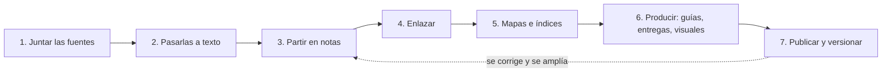

# El método paso a paso

De una fuente cualquiera (PDF, carpeta de Drive, video) a un vault publicado. Son siete pasos, y los mismos sirven para cualquier materia.

## 1. Juntar las fuentes
Primero se identifica **todo** el material, sin resumir nada todavía: consignas y apuntes del profe, entregas del grupo, manuales, videos.
- Drive se recorre con el conector de [[Google Drive]].
- Los videos se listan con [[yt-dlp]].
- Se anota **de dónde sale cada cosa** (nombre del archivo, fecha, link). Por ejemplo, la nota *Archivos en Drive* de AutoLID o las secciones "Fuentes en Drive" de Sistemas Mecánicos. → [[Fuentes y verificación]]

## 2. Pasarlas a texto
La IA no "ve" una carpeta: necesita texto.
- **Docs, Word, PDF con texto:** se leen directo.
- **Videos:** se bajan los subtítulos automáticos y se limpian ([[descargar_transcripciones (script)|descargar_transcripciones.sh]]). Los errores de reconocimiento se corrigen ("Claudia" → "Claude", "cabo uno" → "K1") y se deja anotado qué se corrigió.
- **PDF escaneados:** no tienen texto. Hay que reconocerlo (OCR) o, como en el TP6 de Sistemas Mecánicos, avisar en la nota que no se pudo leer y trabajar desde la teoría.
- **Manuales en inglés:** se traducen completos (manual del torno, 56 páginas).

## 3. Partir en notas
Cada idea va en su propia nota: un equipo, un concepto, un video, un TP. → [[Notas atómicas]]
- Título claro y único (así el enlace funciona solo).
- Al principio, unas líneas de [[Frontmatter y propiedades|propiedades]]: tipo, tags, fecha.
- Un resumen arriba (`> [!summary]`) y el detalle abajo.
- **Con palabras propias:** no se copian las transcripciones ni los apuntes. Las tablas y los datos se citan con su fuente.

## 4. Enlazar
Este es el paso que convierte un montón de notas en una **red**. → [[Enlaces y backlinks]]
- Cada vez que una nota nombra algo que tiene nota propia, se enlaza: `[[Bomba]]`, `[[Punto de rocío]]`.
- Los TP enlazan a los equipos y conceptos que usan; los equipos enlazan de vuelta a los TP donde aparecen.
- Se revisa que no queden **enlaces rotos** (los scripts [[generar_indice (script)|generar_indice.py]] y [[preparar (script)|preparar.py]] los detectan).

## 5. Mapas e índices
- Una **nota índice** por vault (`00 Inicio`), que dice por dónde empezar. → [[Notas índice (MOC)]]
- Un **Canvas** con el mapa visual del tema, y diagramas de Excalidraw o Mermaid cuando ayudan. → [[Canvas y diagramas]]
- Una nota de **método** o **guía** cuando el vault es de estudio.

## 6. Producir
Con la red armada, sacar materiales nuevos es rápido, porque la información ya está ordenada:
- **Guías de estudio**, preguntas de repaso, glosarios. → [[Guías de estudio]]
- **Entregas**: informes en Word o Google Docs, presentaciones en Google Slides. → [[html2docx (script)|html2docx.py]], [[slides_gen (script)|slides_gen.py]], [[torno_tm300_docx (script)|torno_tm300_docx.py]]
- **Visuales**: ilustraciones ([[gemini_img (script)|gemini_img.sh]]), modelo 3D ([[torno_tm300_3d (script)|torno_tm300_3d.py]]), video ([[Publicidad AutoLID]]).

## 7. Publicar y versionar
- Todo se guarda en [[Git y GitHub|GitHub]]. Cada cambio queda registrado. → [[Sincronización]]
- Cada vez que se sube un cambio, la página web se vuelve a armar sola. → [[Publicación automática]]
- Antes de publicar, se sacan los **datos personales** de los compañeros. → [[Privacidad]]

## Quién hace qué
| Paso | La persona | La IA ([[Claude Code]]) |
|---|---|---|
| 1. Fuentes | Decide qué entra y dónde está | Recorre Drive, lista archivos y videos |
| 2. Texto | Revisa lo dudoso | Extrae, transcribe, traduce, corrige |
| 3–5. Notas, enlaces, mapas | Define la estructura y el criterio, revisa | Redacta, enlaza, arma los mapas |
| 6. Producir | Pide lo que necesita, **estudia**, expone | Genera borradores, documentos y scripts |
| 7. Publicar | Aprueba qué se publica | Prepara los commits y la página |

Más detalle en [[Trabajo con IA]].
