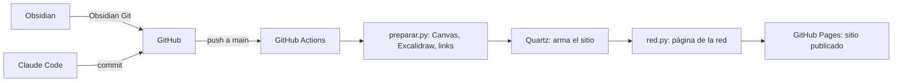

# Publicación automática

Cada vez que llega un cambio a la rama `main` del repositorio, **la página se vuelve a armar sola** y en un par de minutos está actualizada en https://xaguhz.github.io/vaultColegio/.

## Los pasos del workflow (`.github/workflows/publicar.yml`)
1. Baja el repositorio con todo el historial (para las fechas de cada nota).
2. Baja [[Quartz y GitHub Pages|Quartz 4.5.2]] e instala sus dependencias.
3. Corre [[preparar (script)|preparar.py]]: copia los vaults, convierte Canvas y Excalidraw y arregla enlaces.
4. Quartz arma el sitio: buscador, grafo, backlinks, modo oscuro.
5. Copia las páginas propias que Quartz no maneja (visor 3D, web de AutoLID) y arma la [página de la red](https://xaguhz.github.io/vaultColegio/red/) con [[red (script)|red.py]].
6. Publica todo en GitHub Pages.

## Qué ve quien entra
- A la izquierda, el explorador de carpetas, como en Obsidian.
- A la derecha, el grafo local y los backlinks de cada nota.
- **Ctrl+K** busca en todas las notas de todos los vaults.
