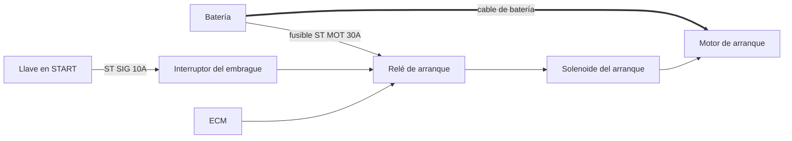

# A-1 · Sistema de arranque

Volver a [[Circuitos eléctricos]] · [[9A Sistemas de cableado]]

PDF: [[Manual de taller Swift 2005-2010.pdf#page=1290|diagrama original, página 1290]] (copia local)

> [!summary] Cómo funciona
> La llave en START alimenta el relé de arranque a través del fusible ST SIG; en este auto manual, el interruptor del pedal de embrague (E74) solo cierra el circuito con el pedal a fondo (en las automáticas lo hace el sensor de rango en P o N). El relé conecta el solenoide del motor de arranque, que toma corriente directa de la batería por el cable grueso.

**En el modelo 3D:** [bateria](https://xaguhz.github.io/vaultColegio/vaultSuzuki/3D/visor/index.html#bateria) · [cable_bateria](https://xaguhz.github.io/vaultColegio/vaultSuzuki/3D/visor/index.html#cable_bateria) · [fusibles](https://xaguhz.github.io/vaultColegio/vaultSuzuki/3D/visor/index.html#fusibles) · [arranque](https://xaguhz.github.io/vaultColegio/vaultSuzuki/3D/visor/index.html#arranque) · [interruptor_embrague](https://xaguhz.github.io/vaultColegio/vaultSuzuki/3D/visor/index.html#interruptor_embrague) · [pedalera](https://xaguhz.github.io/vaultColegio/vaultSuzuki/3D/visor/index.html#pedalera) · [ecu](https://xaguhz.github.io/vaultColegio/vaultSuzuki/3D/visor/index.html#ecu) · [mazo_motor](https://xaguhz.github.io/vaultColegio/vaultSuzuki/3D/visor/index.html#mazo_motor) · en el visor: **Circuitos → A-1**

**Fusibles:** `ST MOT 30A`, `ST SIG 10A`

**Conectores:** `C23` (Motor de arranque #1), `C24` (Motor de arranque #2), `C28`, `C31` (Caja de fusibles principales), `C36` (Mazo de cables principal (a E24)), `E24` (Mazo de cables del motor (a C36)), `E31` (Relé del motor de arranque), `E41` (J/B), `G21` (Interruptor IG), `G32` (J/B)

**Colores de cable:** `BLK`, `BLK/GRY`, `GRN/WHT`, `RED`, `RED/WHT`, `WHT`, `YEL`, `YEL/GRN`
