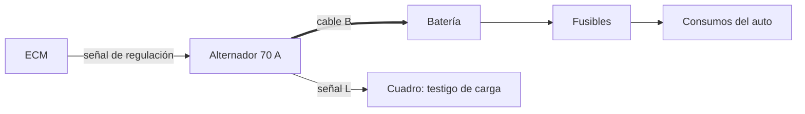

# A-2 · Sistema de carga

Volver a [[Circuitos eléctricos]] · [[9A Sistemas de cableado]]

PDF: [[Manual de taller Swift 2005-2010.pdf#page=1291|diagrama original, página 1291]] (copia local)

> [!summary] Cómo funciona
> El alternador carga la batería; el ECM decide la tensión de regulación (alta o baja) según el consumo y avisa con el testigo de carga en el cuadro.

**En el modelo 3D:** [accesorios](https://xaguhz.github.io/vaultColegio/vaultSuzuki/3D/visor/index.html#accesorios) · [bateria](https://xaguhz.github.io/vaultColegio/vaultSuzuki/3D/visor/index.html#bateria) · [cable_bateria](https://xaguhz.github.io/vaultColegio/vaultSuzuki/3D/visor/index.html#cable_bateria) · [ecu](https://xaguhz.github.io/vaultColegio/vaultSuzuki/3D/visor/index.html#ecu) · [cuadro_instrumentos](https://xaguhz.github.io/vaultColegio/vaultSuzuki/3D/visor/index.html#cuadro_instrumentos) · [mazo_motor](https://xaguhz.github.io/vaultColegio/vaultSuzuki/3D/visor/index.html#mazo_motor) · en el visor: **Circuitos → A-2**

**Fusibles:** `IG COIL 80A`

**Conectores:** `C21`, `C22` (Generador #2), `C33` (Caja de fusibles principales), `C36` (Mazo de cables principal (a E24)), `C39` (Junta de soldadura), `E24` (Mazo de cables del motor (a C36)), `E41` (J/B)

**Colores de cable:** `BLK`, `BLK/WHT`, `WHT/BLU`
