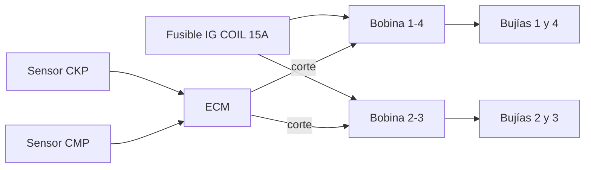

# A-3 · Sistema de encendido

Volver a [[Circuitos eléctricos]] · [[9A Sistemas de cableado]]

PDF: [[Manual de taller Swift 2005-2010.pdf#page=1292|diagrama original, página 1292]] (copia local)

> [!summary] Cómo funciona
> Encendido de chispa perdida: el ECM, con la señal de los sensores de cigüeñal y levas, corta la corriente de cada bobina (1-4 y 2-3) en el momento justo; cada bobina dispara dos bujías a la vez.

**En el modelo 3D:** [bobinas](https://xaguhz.github.io/vaultColegio/vaultSuzuki/3D/visor/index.html#bobinas) · [sensor_ckp](https://xaguhz.github.io/vaultColegio/vaultSuzuki/3D/visor/index.html#sensor_ckp) · [sensor_cmp](https://xaguhz.github.io/vaultColegio/vaultSuzuki/3D/visor/index.html#sensor_cmp) · [ecu](https://xaguhz.github.io/vaultColegio/vaultSuzuki/3D/visor/index.html#ecu) · [tapa_valvulas](https://xaguhz.github.io/vaultColegio/vaultSuzuki/3D/visor/index.html#tapa_valvulas) · [mazo_motor](https://xaguhz.github.io/vaultColegio/vaultSuzuki/3D/visor/index.html#mazo_motor) · [fusibles](https://xaguhz.github.io/vaultColegio/vaultSuzuki/3D/visor/index.html#fusibles) · en el visor: **Circuitos → A-3**

**Fusibles:** `J/B 15A`

**Conectores:** `C02` (Bobina IG #1), `C03` (Bobina IG #2), `C36` (Mazo de cables principal (a E24)), `C37` (ECM), `C39` (Junta de soldadura), `E24` (Mazo de cables del motor (a C36)), `E41` (J/B)

**Colores de cable:** `BLK`, `BLK/WHT`, `GRN/WHT`, `GRN/YEL`
