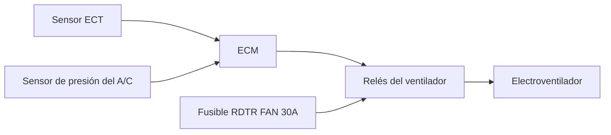

# A-4 · Sistema de refrigeración

Volver a [[Circuitos eléctricos]] · [[9A Sistemas de cableado]]

PDF: [[Manual de taller Swift 2005-2010.pdf#page=1293|diagrama original, página 1293]] (copia local)

> [!summary] Cómo funciona
> Ventilador del radiador: el ECM lee la temperatura del refrigerante (ECT) y la presión del aire acondicionado y activa los relés del ventilador (en baja o alta velocidad).

**En el modelo 3D:** [electroventilador](https://xaguhz.github.io/vaultColegio/vaultSuzuki/3D/visor/index.html#electroventilador) · [sensor_ect](https://xaguhz.github.io/vaultColegio/vaultSuzuki/3D/visor/index.html#sensor_ect) · [sensor_presion_ac](https://xaguhz.github.io/vaultColegio/vaultSuzuki/3D/visor/index.html#sensor_presion_ac) · [ecu](https://xaguhz.github.io/vaultColegio/vaultSuzuki/3D/visor/index.html#ecu) · [fusibles](https://xaguhz.github.io/vaultColegio/vaultSuzuki/3D/visor/index.html#fusibles) · [mazo_motor](https://xaguhz.github.io/vaultColegio/vaultSuzuki/3D/visor/index.html#mazo_motor) · en el visor: **Circuitos → A-4**

**Fusibles:** `FAN 30A`

**Conectores:** `E17` (Motor del ventilador del radiador), `E28` (Relé de ventilador de radiador #1), `E29` (Relé de ventilador de radiador #2), `E30` (Relé de ventilador de radiador #3), `E32` (Relé principal), `E55` (Junta de soldadura)

**Colores de cable:** `BLK`, `BLK/RED`, `BLK/YEL`, `BLU/BLK`, `BLU/RED`, `BLU/WHT`, `BRN/WHT`, `GRN`, `GRY`, `LT GRN`
