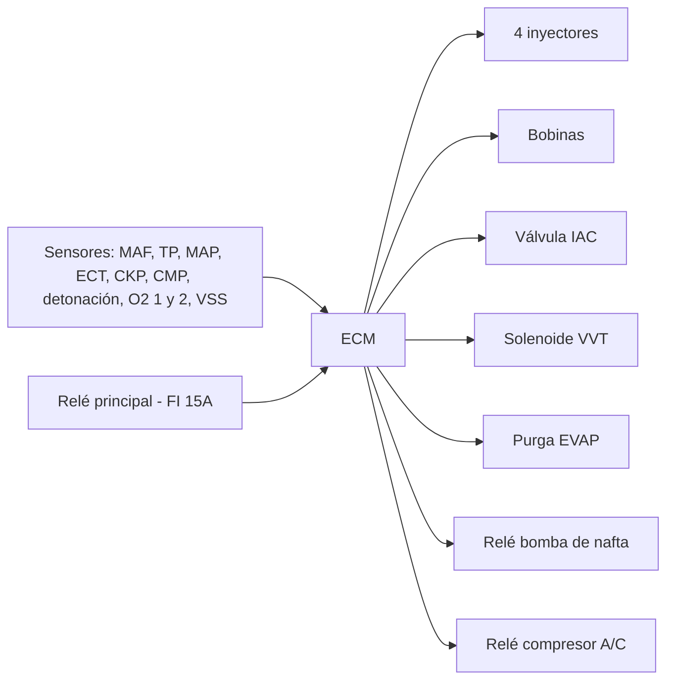

# A-5 · Sistema de control del A/C y del motor

Volver a [[Circuitos eléctricos]] · [[9A Sistemas de cableado]]

PDF: [[Manual de taller Swift 2005-2010.pdf#page=1294|diagrama original, página 1294]] (copia local)

> [!summary] Cómo funciona
> Control del motor: el ECM recibe aire (MAF), mariposa (TP), presión del colector (MAP), temperaturas, cigüeñal y levas, detonación, sondas de oxígeno y velocidad; y maneja inyectores, bobinas, válvula de ralentí, VVT, purga del canister, relé de la bomba de nafta y el embrague del compresor del A/C.

**En el modelo 3D:** [ecu](https://xaguhz.github.io/vaultColegio/vaultSuzuki/3D/visor/index.html#ecu) · [sensor_maf](https://xaguhz.github.io/vaultColegio/vaultSuzuki/3D/visor/index.html#sensor_maf) · [sensor_tp](https://xaguhz.github.io/vaultColegio/vaultSuzuki/3D/visor/index.html#sensor_tp) · [sensor_map](https://xaguhz.github.io/vaultColegio/vaultSuzuki/3D/visor/index.html#sensor_map) · [sensor_ect](https://xaguhz.github.io/vaultColegio/vaultSuzuki/3D/visor/index.html#sensor_ect) · [sensor_ckp](https://xaguhz.github.io/vaultColegio/vaultSuzuki/3D/visor/index.html#sensor_ckp) · [sensor_cmp](https://xaguhz.github.io/vaultColegio/vaultSuzuki/3D/visor/index.html#sensor_cmp) · [sensor_detonacion](https://xaguhz.github.io/vaultColegio/vaultSuzuki/3D/visor/index.html#sensor_detonacion) · [sonda_o2_1](https://xaguhz.github.io/vaultColegio/vaultSuzuki/3D/visor/index.html#sonda_o2_1) · [sonda_o2_2](https://xaguhz.github.io/vaultColegio/vaultSuzuki/3D/visor/index.html#sonda_o2_2) · [sensor_vss](https://xaguhz.github.io/vaultColegio/vaultSuzuki/3D/visor/index.html#sensor_vss) · [inyectores](https://xaguhz.github.io/vaultColegio/vaultSuzuki/3D/visor/index.html#inyectores) · [bobinas](https://xaguhz.github.io/vaultColegio/vaultSuzuki/3D/visor/index.html#bobinas) · [valvula_iac](https://xaguhz.github.io/vaultColegio/vaultSuzuki/3D/visor/index.html#valvula_iac) · [solenoide_vvt](https://xaguhz.github.io/vaultColegio/vaultSuzuki/3D/visor/index.html#solenoide_vvt) · [valvula_purga](https://xaguhz.github.io/vaultColegio/vaultSuzuki/3D/visor/index.html#valvula_purga) · [tanque](https://xaguhz.github.io/vaultColegio/vaultSuzuki/3D/visor/index.html#tanque) · [accesorios](https://xaguhz.github.io/vaultColegio/vaultSuzuki/3D/visor/index.html#accesorios) · [mazo_motor](https://xaguhz.github.io/vaultColegio/vaultSuzuki/3D/visor/index.html#mazo_motor) · [mazo_principal](https://xaguhz.github.io/vaultColegio/vaultSuzuki/3D/visor/index.html#mazo_principal) · [fusibles](https://xaguhz.github.io/vaultColegio/vaultSuzuki/3D/visor/index.html#fusibles) · en el visor: **Circuitos → A-5**

**Fusibles:** `J/B 15A`, `RADIO 15A`

**Conectores:** `C01` (Válvula de IAC), `C04` (Inyector #1), `C05` (Inyector #2), `C06` (Inyector #3), `C07` (Inyector #4), `C08` (Sensor de CMP), `C09` (Sensor de ECT), `C10` (Motor de velocidad gradual EGR), `C11` (Sensor de posición de la mariposa), `C12` (Sensor de MAP), `C13` (Sensor de MAF), `C14` (Válvula de purga del recipiente de EVAP), `C15` (Sonda de oxígeno calentado #1), `C16` (Sonda de oxígeno calentado #2), `C17` (Compresor del A/C), `C19` (Solenoide VVT), `C20` (Sensor de CKP), `C25` (Sensor de velocidad del vehículo), `C26` (Sensor de detonación), `C32`, `C34` (TCM), `C36` (Mazo de cables principal (a E24)), `C37` (ECM), `C38` (Junta de soldadura), `C40` (Junta de soldadura), `E04` (Sensor de presión del A/C), `E23` (ECM), `E24` (Mazo de cables del motor (a C36)), `E28` (Relé de ventilador de radiador #1), `E32` (Relé principal), `E35` (Relé de la bomba de combustible), `E36` (Relé del compresor del A/C), `E38` ((ver la página del PDF)), `E39` (J/B), `E41` (J/B), `E42` (J/C), `E43` (J/C), `E45`, `E46` (BCM), `E55` (Junta de soldadura), `E57`, `G09` (Termistor EVAP), `G15` (J/C), `G16` (J/C), `G17` (J/C), `G20` (DLC), `G33` (J/B), `G36` (Mazo de cables principal (a E38)), `G37` (BCM), `L02` (Mazo de cables principal (a E44)), `L15` ((ver la página del PDF)), `R01` (Mazo de cables del suelo (a L15)), `R02` (Bomba de combustible y manómetro), `R03`

**Colores de cable:** `BLK`, `BLK/ORN`, `BLK/RED`, `BLK/WHT`, `BLK/YEL`, `BLU`, `BLU/BLK`, `BLU/GRN`, `BLU/RED`, `BLU/WHT`, `BLU/YEL`, `BRN`, `BRN/WHT`, `BRN/YEL`, `GRN`, `GRN/BLK`, `GRN/ORN`, `GRN/RED`, `GRN/WHT`, `GRY`, `GRY/BLU`, `GRY/RED`, `LT GRN`, `ORN`, `PNK`, `PPL`, `PPL/WHT`, `RED`, `RED/BLU`, `RED/WHT`, `RED/YEL`, `WHT`, `WHT/BLK`, `WHT/RED`, `YEL`, `YEL/BLK`, `YEL/GRN`, `YEL/RED`
