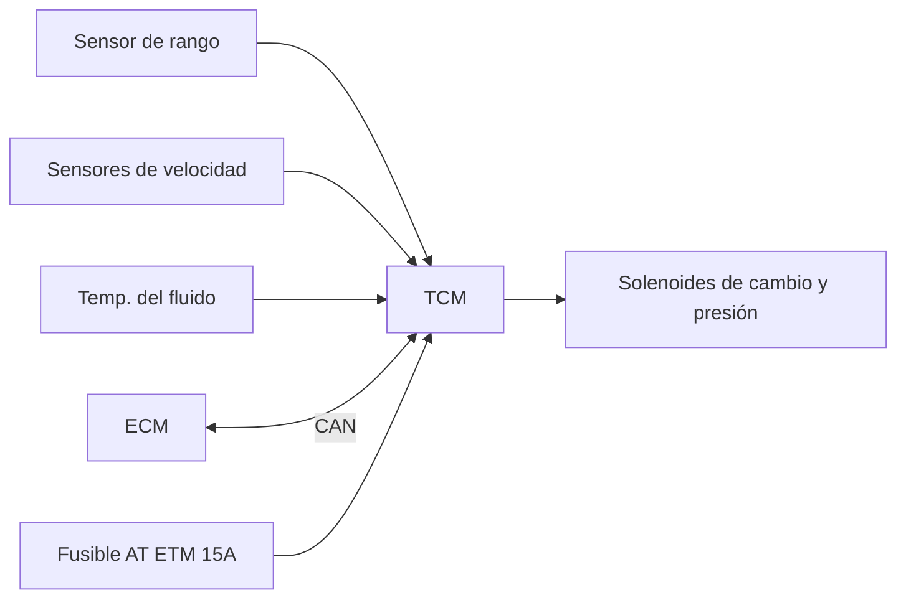

# A-6 · Sistema de control del A/T

Volver a [[Circuitos eléctricos]] · [[9A Sistemas de cableado]]

PDF: [[Manual de taller Swift 2005-2010.pdf#page=1299|diagrama original, página 1299]] (copia local)

> [!summary] Cómo funciona
> Caja automática: el TCM lee el sensor de rango, las velocidades de entrada y salida, la temperatura del fluido y la mariposa (vía ECM) y maneja los solenoides de cambio y de presión.

**En el modelo 3D:** [tcm](https://xaguhz.github.io/vaultColegio/vaultSuzuki/3D/visor/index.html#tcm) · [sensor_rango_caja](https://xaguhz.github.io/vaultColegio/vaultSuzuki/3D/visor/index.html#sensor_rango_caja) · [caja_4at](https://xaguhz.github.io/vaultColegio/vaultSuzuki/3D/visor/index.html#caja_4at) · [caja_cuerpo_valvulas](https://xaguhz.github.io/vaultColegio/vaultSuzuki/3D/visor/index.html#caja_cuerpo_valvulas) · [ecu](https://xaguhz.github.io/vaultColegio/vaultSuzuki/3D/visor/index.html#ecu) · [mazo_motor](https://xaguhz.github.io/vaultColegio/vaultSuzuki/3D/visor/index.html#mazo_motor) · [palanca](https://xaguhz.github.io/vaultColegio/vaultSuzuki/3D/visor/index.html#palanca) · en el visor: **Circuitos → A-6**

**Fusibles:** `BACK 10A`, `IG1 SIG 15A`, `LAMP 15A`, `RADIO 15A`

**Conectores:** `C27`, `C28`, `C29`, `C34` (TCM), `C35`, `C36` (Mazo de cables principal (a E24)), `C37` (ECM), `E23` (ECM), `E24` (Mazo de cables del motor (a C36)), `E33` (Relé A/T), `E38` (E45/N), `E39` (J/B), `E41` (J/B), `E42` (J/C), `E43` (J/C), `E45`, `E46` (BCM), `E47` (Interruptor de luces de freno), `E62`, `G15` (J/C), `G16` (J/C), `G17` (J/C), `G20` (DLC), `G33` (J/B), `G36` (Mazo de cables principal (a E38)), `G37` (BCM), `L01` (BCM), `L02` (Mazo de cables principal (a E44)), `L23` (Palanca de cambios A/T), `L24` (J/C)

**Colores de cable:** `BLK`, `BLK/ORN`, `BLK/YEL`, `BLU/BLK`, `BRN`, `GRN`, `GRN/ORN`, `GRN/WHT`, `GRN/YEL`, `GRY`, `LT GRN`, `LT GRN/BLK`, `ORN`, `PNK`, `PNK/BLK`, `PPL`, `PPL/WHT`, `PPL/YEL`, `RED`, `RED/BLK`, `WHT`, `WHT/BLK`, `WHT/BLU`, `WHT/RED`, `YEL/BLK`, `YEL/BLU`
