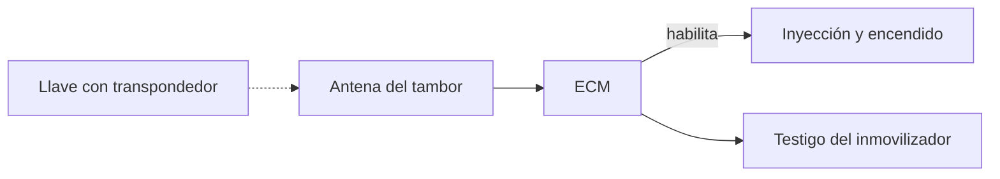

# A-7 · Sistema del inmovilizador

Volver a [[Circuitos eléctricos]] · [[9A Sistemas de cableado]]

PDF: [[Manual de taller Swift 2005-2010.pdf#page=1301|diagrama original, página 1301]] (copia local)

> [!summary] Cómo funciona
> Inmovilizador: la antena del tambor de la llave lee el código del transpondedor; si coincide con el registrado, el ECM habilita la inyección y el encendido.

**En el modelo 3D:** [antena_inmovilizador](https://xaguhz.github.io/vaultColegio/vaultSuzuki/3D/visor/index.html#antena_inmovilizador) · [ecu](https://xaguhz.github.io/vaultColegio/vaultSuzuki/3D/visor/index.html#ecu) · [cuadro_instrumentos](https://xaguhz.github.io/vaultColegio/vaultSuzuki/3D/visor/index.html#cuadro_instrumentos) · [mazo_tablero](https://xaguhz.github.io/vaultColegio/vaultSuzuki/3D/visor/index.html#mazo_tablero) · en el visor: **Circuitos → A-7**

**Fusibles:** `RADIO 15A`

**Conectores:** `C36` (Mazo de cables principal (a E24)), `E23` (ECM), `E24` (Mazo de cables del motor (a C36)), `E38` ((ver la página del PDF)), `E41` (J/B), `E42` (J/C), `E43` (J/C), `E46` (BCM), `G15` (J/C), `G16` (J/C), `G17` (J/C), `G20` (DLC), `G24` (ICM), `G33` (J/B), `G34` (J/B), `G36` (Mazo de cables principal (a E38)), `G37` (BCM)

**Colores de cable:** `BLK`, `BLK/ORN`, `BLK/WHT`, `PPL/WHT`, `RED/BLK`, `WHT/BLK`, `WHT/RED`, `YEL/BLK`, `YEL/RED`
