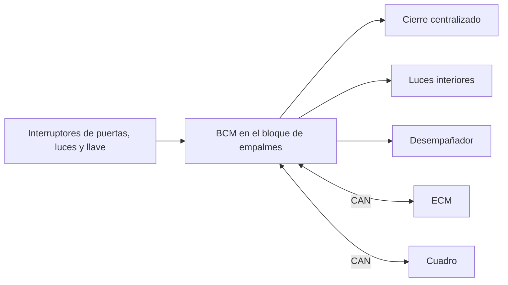

# A-8 · Sistema de control de la carrocería

Volver a [[Circuitos eléctricos]] · [[9A Sistemas de cableado]]

PDF: [[Manual de taller Swift 2005-2010.pdf#page=1302|diagrama original, página 1302]] (copia local)

> [!summary] Cómo funciona
> Control de la carrocería: el BCM, integrado en el bloque de empalmes, recibe los interruptores (puertas, luces, llave) y maneja cierre, luces de cortesía, desempañador y avisos; habla con el ECM y el cuadro por CAN.

**En el modelo 3D:** [bloque_empalmes](https://xaguhz.github.io/vaultColegio/vaultSuzuki/3D/visor/index.html#bloque_empalmes) · [cerraduras](https://xaguhz.github.io/vaultColegio/vaultSuzuki/3D/visor/index.html#cerraduras) · [desempanador](https://xaguhz.github.io/vaultColegio/vaultSuzuki/3D/visor/index.html#desempanador) · [techo_interior](https://xaguhz.github.io/vaultColegio/vaultSuzuki/3D/visor/index.html#techo_interior) · [ecu](https://xaguhz.github.io/vaultColegio/vaultSuzuki/3D/visor/index.html#ecu) · [cuadro_instrumentos](https://xaguhz.github.io/vaultColegio/vaultSuzuki/3D/visor/index.html#cuadro_instrumentos) · [mazo_principal](https://xaguhz.github.io/vaultColegio/vaultSuzuki/3D/visor/index.html#mazo_principal) · [mazo_puertas](https://xaguhz.github.io/vaultColegio/vaultSuzuki/3D/visor/index.html#mazo_puertas) · en el visor: **Circuitos → A-8**

**Fusibles:** `ACC 1 15A`, `ACC 50A`, `D/L 20A`, `J/B 15A`, `METER 10A`, `RADIO 15A`

**Conectores:** `C36` (Mazo de cables principal (a E24)), `E24` (Mazo de cables del motor (a C36)), `E26` (Caja de fusibles principales), `E38` (E45/N), `E40` (J/B), `E41` (J/B), `E42` (J/C), `E43` (J/C), `E46` (BCM), `G15` (J/C), `G16` (J/C), `G17` (J/C), `G20` (DLC), `G21` (Interruptor IG), `G32` (J/B), `G33` (J/B), `G34` (J/B), `G36` (Mazo de cables principal (a E38)), `G37` (BCM), `K01` (J/B), `L01` (BCM), `L04` (J/B), `L06` (J/B), `L08` (J/C), `L09` (J/C)

**Colores de cable:** `BLK`, `BLK/ORN`, `BLK/RED`, `BLK/YEL`, `BLU`, `BLU/BLK`, `BLU/YEL`, `BRN`, `BRN/WHT`, `GRN`, `GRN/WHT`, `GRY`, `GRY/RED`, `GRY/WHT`, `LT GRN`, `LT GRN/BLK`, `PNK`, `PPL/WHT`, `RED`, `RED/BLK`, `RED/BLU`, `RED/YEL`, `WHT`, `WHT/BLU`, `WHT/RED`, `YEL`, `YEL/BLK`, `YEL/RED`
