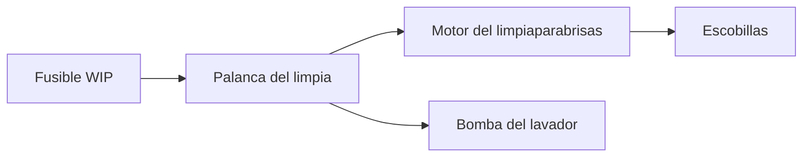

# B-1 · Limpiaparabrisas y lavaparabrisas

Volver a [[Circuitos eléctricos]] · [[9A Sistemas de cableado]]

PDF: [[Manual de taller Swift 2005-2010.pdf#page=1306|diagrama original, página 1306]] (copia local)

> [!summary] Cómo funciona
> Limpiaparabrisas: la palanca elige intermitente, baja o alta; el motor tiene un contacto de parada para que las escobillas queden abajo. El lavador es una bomba en el depósito.

**En el modelo 3D:** [motor_limpiaparabrisas](https://xaguhz.github.io/vaultColegio/vaultSuzuki/3D/visor/index.html#motor_limpiaparabrisas) · [limpiaparabrisas](https://xaguhz.github.io/vaultColegio/vaultSuzuki/3D/visor/index.html#limpiaparabrisas) · [lavador](https://xaguhz.github.io/vaultColegio/vaultSuzuki/3D/visor/index.html#lavador) · [columna_eps](https://xaguhz.github.io/vaultColegio/vaultSuzuki/3D/visor/index.html#columna_eps) · [mazo_principal](https://xaguhz.github.io/vaultColegio/vaultSuzuki/3D/visor/index.html#mazo_principal) · en el visor: **Circuitos → B-1**

**Fusibles:** `WIPER 15A`

**Conectores:** `E01` (Motor del limpiaparabrisas), `E11` (Motor del lavaparabrisas), `E37`, `E39` (J/B), `G23` (Interruptor COMB), `G33` (J/B), `G35` (Mazo de cables principal (a E37))

**Colores de cable:** `BLK`, `BLU/ORN`, `YEL`
