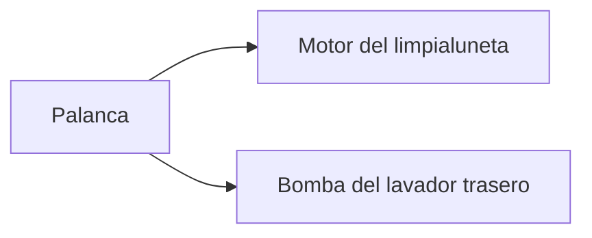

# B-2 · Limpialunetas y lavalunetas

Volver a [[Circuitos eléctricos]] · [[9A Sistemas de cableado]]

PDF: [[Manual de taller Swift 2005-2010.pdf#page=1307|diagrama original, página 1307]] (copia local)

> [!summary] Cómo funciona
> Limpialuneta: motor en el portón con su propia bomba de lavado.

**En el modelo 3D:** [motor_limpialuneta](https://xaguhz.github.io/vaultColegio/vaultSuzuki/3D/visor/index.html#motor_limpialuneta) · [porton](https://xaguhz.github.io/vaultColegio/vaultSuzuki/3D/visor/index.html#porton) · [lavador](https://xaguhz.github.io/vaultColegio/vaultSuzuki/3D/visor/index.html#lavador) · [mazo_porton](https://xaguhz.github.io/vaultColegio/vaultSuzuki/3D/visor/index.html#mazo_porton) · en el visor: **Circuitos → B-2**

**Fusibles:** `WIPER 20A`

**Conectores:** `E10` (Motor del lavaparabrisas trasero), `E37`, `E39` (J/B), `G15` (J/C), `G23` (Interruptor COMB), `G34` (J/B), `G35` (Mazo de cables principal (a E37)), `G37` (BCM), `L05` (J/B), `L42` (Cable de la puerta trasera (a O01)), `O01` (Mazo de cables del suelo (a L42)), `O03` (Motor del limpialunetas)

**Colores de cable:** `BLK`, `ORN`, `YEL`, `YEL/RED`
