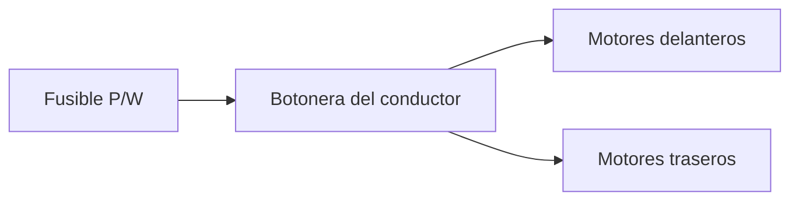

# B-4 · Elevalunas eléctrico

Volver a [[Circuitos eléctricos]] · [[9A Sistemas de cableado]]

PDF: [[Manual de taller Swift 2005-2010.pdf#page=1309|diagrama original, página 1309]] (copia local)

> [!summary] Cómo funciona
> Levantavidrios eléctricos: la botonera del conductor alimenta cada motor invirtiendo la polaridad para subir o bajar.

**En el modelo 3D:** [levantavidrios_izq](https://xaguhz.github.io/vaultColegio/vaultSuzuki/3D/visor/index.html#levantavidrios_izq) · [levantavidrios_der](https://xaguhz.github.io/vaultColegio/vaultSuzuki/3D/visor/index.html#levantavidrios_der) · [mazo_puertas](https://xaguhz.github.io/vaultColegio/vaultSuzuki/3D/visor/index.html#mazo_puertas) · en el visor: **Circuitos → B-4**

**Fusibles:** `P/W 30A`

**Conectores:** `J01` (Mazo de cables del suelo (a L07)), `J05` (Interruptor de solicitud (lado del conductor)), `J08` (Interruptor principal del elevalunas eléctrico), `J09` (Mazo de cables del suelo (a L03)), `J14`, `J15`, `J16` (Mazo de cables del suelo (a L13)), `J18` (Motor del elevalunas eléctrico trasero (R)), `J19` ((ver la página del PDF)), `J21` (Mazo de cables del suelo (a L37)), `J23` (Motor del elevalunas eléctrico trasero (L)), `J24`, `L05` (J/B), `L07` ((ver la página del PDF)), `L08` (J/C), `L09` (J/C), `L13` (Cable de la puerta trasera (R) (a J16)), `L31`, `L37` (Cable de la puerta trasera (L) (a J21))

**Colores de cable:** `BLK`, `BLU/YEL`, `GRN`, `GRN/WHT`, `GRN/YEL`, `RED`, `RED/BLK`, `RED/WHT`, `WHT/BLU`, `WHT/GRN`
