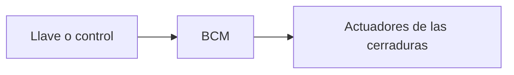

# B-5 · Cierre centralizado

Volver a [[Circuitos eléctricos]] · [[9A Sistemas de cableado]]

PDF: [[Manual de taller Swift 2005-2010.pdf#page=1311|diagrama original, página 1311]] (copia local)

> [!summary] Cómo funciona
> Cierre centralizado: el BCM recibe la cerradura del conductor o el control remoto y mueve los actuadores de las cuatro puertas y el portón.

**En el modelo 3D:** [cerraduras](https://xaguhz.github.io/vaultColegio/vaultSuzuki/3D/visor/index.html#cerraduras) · [bloque_empalmes](https://xaguhz.github.io/vaultColegio/vaultSuzuki/3D/visor/index.html#bloque_empalmes) · [mazo_puertas](https://xaguhz.github.io/vaultColegio/vaultSuzuki/3D/visor/index.html#mazo_puertas) · en el visor: **Circuitos → B-5**

**Fusibles:** `D/L 20A`

**Conectores:** `G02` (Receptor sin llaves), `G37` (BCM), `J01` (Mazo de cables del suelo (a L07)), `J06` ((ver la página del PDF)), `J08` (Interruptor principal del elevalunas eléctrico), `J09` (Mazo de cables del suelo (a L03)), `J13`, `J16` (Mazo de cables del suelo (a L13)), `J20` ((ver la página del PDF)), `J21` (Mazo de cables del suelo (a L37)), `J25`, `L01` (BCM), `L06` (J/B), `L07` ((ver la página del PDF)), `L08` (J/C), `L09` (J/C), `L13` (Cable de la puerta trasera (R) (a J16)), `L31`, `L37` (Cable de la puerta trasera (L) (a J21)), `L42` (Cable de la puerta trasera (a O01)), `O01` (Mazo de cables del suelo (a L42)), `O04` (Solenoide de bloqueo de la puerta trasera), `O05`

**Colores de cable:** `BLK`, `BLU/YEL`, `BRN`, `BRN/WHT`, `GRN`, `GRN/RED`, `GRY`, `GRY/WHT`, `LT GRN`, `LT GRN/BLK`, `PNK`, `RED/BLU`, `WHT`
