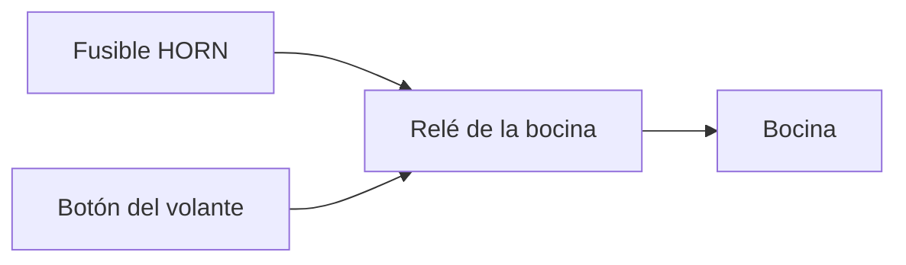

# B-7 · La bocina

Volver a [[Circuitos eléctricos]] · [[9A Sistemas de cableado]]

PDF: [[Manual de taller Swift 2005-2010.pdf#page=1314|diagrama original, página 1314]] (copia local)

> [!summary] Cómo funciona
> Bocina: el botón del volante cierra a masa el relé de la bocina.

**En el modelo 3D:** [bocina](https://xaguhz.github.io/vaultColegio/vaultSuzuki/3D/visor/index.html#bocina) · [volante](https://xaguhz.github.io/vaultColegio/vaultSuzuki/3D/visor/index.html#volante) · [mazo_principal](https://xaguhz.github.io/vaultColegio/vaultSuzuki/3D/visor/index.html#mazo_principal) · en el visor: **Circuitos → B-7**

**Fusibles:** `METER 10A`

**Conectores:** `E15` (Claxon), `E41` (J/B), `G15` (J/C), `G27` (Interruptor COMB), `G34` (J/B)

**Colores de cable:** `BLK`, `BLU`, `GRN`
