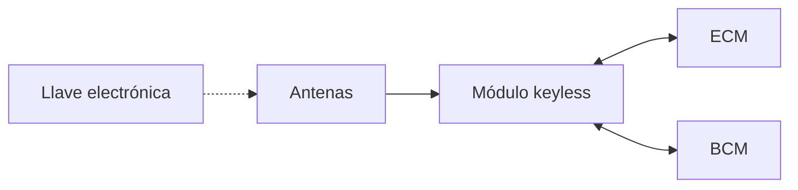

# B-9 · Sistema de arranque sin llave

Volver a [[Circuitos eléctricos]] · [[9A Sistemas de cableado]]

PDF: [[Manual de taller Swift 2005-2010.pdf#page=1316|diagrama original, página 1316]] (copia local)

> [!summary] Cómo funciona
> Arranque sin llave (si el auto lo trae): antenas en el habitáculo, módulo de control y comunicación con el ECM y el BCM.

**En el modelo 3D:** [modulo_keyless](https://xaguhz.github.io/vaultColegio/vaultSuzuki/3D/visor/index.html#modulo_keyless) · [ecu](https://xaguhz.github.io/vaultColegio/vaultSuzuki/3D/visor/index.html#ecu) · [bloque_empalmes](https://xaguhz.github.io/vaultColegio/vaultSuzuki/3D/visor/index.html#bloque_empalmes) · en el visor: **Circuitos → B-9**

**Fusibles:** `ACC2 15A`, `J/B 10A`

**Conectores:** `G03` (Mazo de cables del suelo (a L33)), `G15` (J/C), `G17` (J/C), `G31` (J/C), `G33` (J/B), `G34` (J/B), `G42`, `G43`, `J01` (Mazo de cables del suelo (a L07)), `J09` (Mazo de cables del suelo (a L03)), `J26`, `J27`, `J28`, `J29`, `L07` (L31/N), `L31`, `L33`, `L42` (Cable de la puerta trasera (a O01)), `L51`, `O01` (Mazo de cables del suelo (a L42))

**Colores de cable:** `BLK`, `BLK/ORN`, `BLK/YEL`, `BLU/RED`, `BLU/WHT`, `BLU/YEL`, `BRN`, `BRN/YEL`, `GRN`, `GRN/WHT`, `GRY/BLU`, `LT GRN`, `ORN`, `PNK/BLK`, `PPL`, `RED`, `RED/BLK`, `RED/BLU`, `WHT`, `WHT/BLK`, `WHT/GRN`, `WHT/RED`, `YEL`
