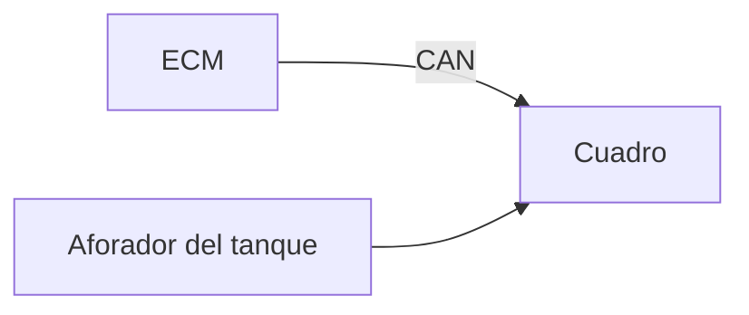

# C-1 · Juego de instrumentos (medidor)

Volver a [[Circuitos eléctricos]] · [[9A Sistemas de cableado]]

PDF: [[Manual de taller Swift 2005-2010.pdf#page=1317|diagrama original, página 1317]] (copia local)

> [!summary] Cómo funciona
> Relojes del cuadro: velocidad (por CAN desde el ECM), vueltas, nafta (aforador del tanque) y temperatura.

**En el modelo 3D:** [cuadro_instrumentos](https://xaguhz.github.io/vaultColegio/vaultSuzuki/3D/visor/index.html#cuadro_instrumentos) · [ecu](https://xaguhz.github.io/vaultColegio/vaultSuzuki/3D/visor/index.html#ecu) · [tanque](https://xaguhz.github.io/vaultColegio/vaultSuzuki/3D/visor/index.html#tanque) · [mazo_tablero](https://xaguhz.github.io/vaultColegio/vaultSuzuki/3D/visor/index.html#mazo_tablero) · en el visor: **Circuitos → C-1**

**Fusibles:** `J/B 15A`, `METER 10A`

**Conectores:** `G28` (Medidor COMB), `G33` (J/B)

**Colores de cable:** `RED`, `RED/BLK`, `WHT`, `WHT/RED`
