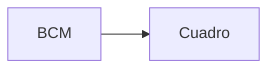

# C-2 · Juego de instrumentos (indicador)

Volver a [[Circuitos eléctricos]] · [[9A Sistemas de cableado]]

PDF: [[Manual de taller Swift 2005-2010.pdf#page=1318|diagrama original, página 1318]] (copia local)

> [!summary] Cómo funciona
> Indicadores del cuadro: giros, luz alta y, en las automáticas, la marcha seleccionada.

**En el modelo 3D:** [cuadro_instrumentos](https://xaguhz.github.io/vaultColegio/vaultSuzuki/3D/visor/index.html#cuadro_instrumentos) · [bloque_empalmes](https://xaguhz.github.io/vaultColegio/vaultSuzuki/3D/visor/index.html#bloque_empalmes) · en el visor: **Circuitos → C-2**

**Fusibles:** `METER 10A`

**Conectores:** `G28` (Medidor COMB), `G33` (J/B), `G34` (J/B)

**Colores de cable:** `BLU/ORN`, `BLU/RED`, `BLU/YEL`, `GRN/RED`, `RED`, `RED/BLK`, `RED/BLU`, `WHT`, `WHT/RED`
