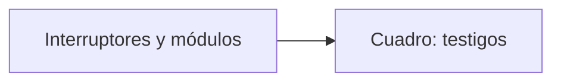

# C-3 · Juego de instrumentos (indicador de advertencia)

Volver a [[Circuitos eléctricos]] · [[9A Sistemas de cableado]]

PDF: [[Manual de taller Swift 2005-2010.pdf#page=1319|diagrama original, página 1319]] (copia local)

> [!summary] Cómo funciona
> Testigos de advertencia: aceite, carga, frenos, ABS, airbag, EPS, motor, cinturón, puertas.

**En el modelo 3D:** [cuadro_instrumentos](https://xaguhz.github.io/vaultColegio/vaultSuzuki/3D/visor/index.html#cuadro_instrumentos) · [sensor_presion_aceite](https://xaguhz.github.io/vaultColegio/vaultSuzuki/3D/visor/index.html#sensor_presion_aceite) · [interruptor_nivel_freno](https://xaguhz.github.io/vaultColegio/vaultSuzuki/3D/visor/index.html#interruptor_nivel_freno) · [abs](https://xaguhz.github.io/vaultColegio/vaultSuzuki/3D/visor/index.html#abs) · [sdm](https://xaguhz.github.io/vaultColegio/vaultSuzuki/3D/visor/index.html#sdm) · [modulo_eps](https://xaguhz.github.io/vaultColegio/vaultSuzuki/3D/visor/index.html#modulo_eps) · en el visor: **Circuitos → C-3**

**Fusibles:** `J/B 15A`, `METER 10A`

**Conectores:** `C18` (Sensor de presión de aceite), `C36` (Mazo de cables principal (a E24)), `E02` (Interruptor de nivel del líquido de frenos), `E24` (Mazo de cables del motor (a C36)), `E37`, `E46` (BCM), `G28` (Medidor COMB), `G33` (J/B), `G35` (Mazo de cables principal (a E37)), `G37` (BCM), `L01` (BCM), `L24` (J/C), `L27` (Interruptor del freno de estacionamiento)

**Colores de cable:** `BLK`, `BLK/ORN`, `BLU`, `BRN/YEL`, `GRY`, `PNK/BLK`, `RED`, `RED/BLK`, `RED/BLU`, `WHT`, `WHT/RED`, `YEL/BLK`
