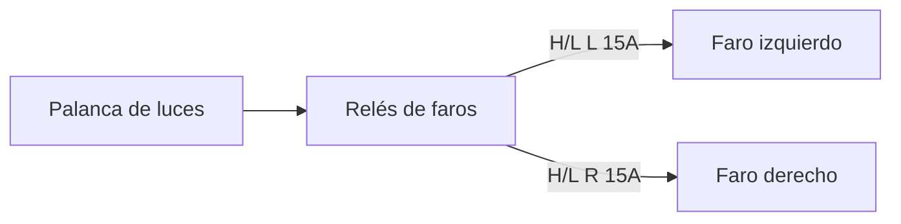

# D-1 · Sistema de faros

Volver a [[Circuitos eléctricos]] · [[9A Sistemas de cableado]]

PDF: [[Manual de taller Swift 2005-2010.pdf#page=1321|diagrama original, página 1321]] (copia local)

> [!summary] Cómo funciona
> Faros: la palanca de luces activa los relés de luz alta y baja; cada faro tiene su fusible.

**En el modelo 3D:** [faro_izq](https://xaguhz.github.io/vaultColegio/vaultSuzuki/3D/visor/index.html#faro_izq) · [faro_der](https://xaguhz.github.io/vaultColegio/vaultSuzuki/3D/visor/index.html#faro_der) · [fusibles](https://xaguhz.github.io/vaultColegio/vaultSuzuki/3D/visor/index.html#fusibles) · [mazo_principal](https://xaguhz.github.io/vaultColegio/vaultSuzuki/3D/visor/index.html#mazo_principal) · en el visor: **Circuitos → D-1**

**Fusibles:** `METER 10A`

**Conectores:** `E08` (Faro (derecho)), `E21` (Faro (R)), `E37`, `E42` (J/C), `E43` (J/C), `G25` (Interruptor COMB), `G28` (Medidor COMB), `G33` (J/B), `G34` (J/B), `G35` (Mazo de cables principal (a E37))

**Colores de cable:** `BLK`, `BLU/WHT`, `RED`, `RED/BLK`, `RED/WHT`, `RED/YEL`, `WHT/BLU`, `WHT/RED`
