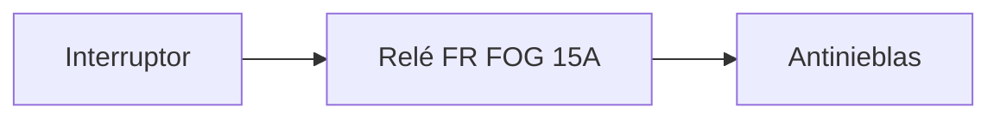

# D-3 · Sistema de los faros antiniebla delanteros

Volver a [[Circuitos eléctricos]] · [[9A Sistemas de cableado]]

PDF: [[Manual de taller Swift 2005-2010.pdf#page=1324|diagrama original, página 1324]] (copia local)

> [!summary] Cómo funciona
> Faros antiniebla delanteros con su relé y fusible FR FOG.

**En el modelo 3D:** [antiniebla_izq](https://xaguhz.github.io/vaultColegio/vaultSuzuki/3D/visor/index.html#antiniebla_izq) · [antiniebla_der](https://xaguhz.github.io/vaultColegio/vaultSuzuki/3D/visor/index.html#antiniebla_der) · [fusibles](https://xaguhz.github.io/vaultColegio/vaultSuzuki/3D/visor/index.html#fusibles) · en el visor: **Circuitos → D-3**

**Fusibles:** `FOG 15A`

**Conectores:** `E12`, `E18`, `E34`, `E37`, `G15` (J/C), `G29`, `G31` (J/C), `G34` (J/B), `G35` (Mazo de cables principal (a E37))

**Colores de cable:** `BLK`, `BLK/YEL`, `GRY/RED`, `LT GRN`, `RED/YEL`, `WHT/GRN`
