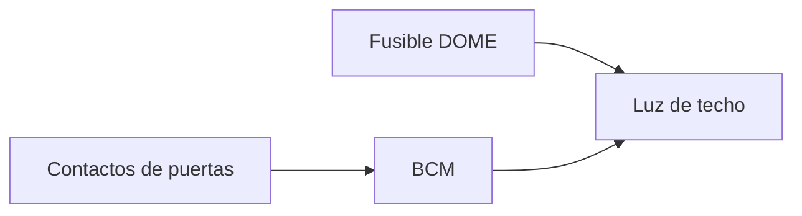

# D-5 · Sistema de las luces interiores

Volver a [[Circuitos eléctricos]] · [[9A Sistemas de cableado]]

PDF: [[Manual de taller Swift 2005-2010.pdf#page=1326|diagrama original, página 1326]] (copia local)

> [!summary] Cómo funciona
> Luces interiores: techo y baúl, encendidas por las puertas a través del BCM.

**En el modelo 3D:** [techo_interior](https://xaguhz.github.io/vaultColegio/vaultSuzuki/3D/visor/index.html#techo_interior) · [bloque_empalmes](https://xaguhz.github.io/vaultColegio/vaultSuzuki/3D/visor/index.html#bloque_empalmes) · en el visor: **Circuitos → D-5**

**Fusibles:** `RADIO 15A`

**Conectores:** `G15` (J/C), `G34` (J/B), `K01` (J/B), `K02` (Luz interior), `L01` (BCM), `L05` (J/B), `L12` ((ver la página del PDF)), `L16` (Interruptor de la puerta trasera (R)), `L19` (Luz del compartimiento de equipajes), `L40` (Interruptor de la puerta trasera (L)), `L42` (Cable de la puerta trasera (a O01)), `O01` (Mazo de cables del suelo (a L42)), `O04` (Solenoide de bloqueo de la puerta trasera)

**Colores de cable:** `BLK`, `BLK/RED`, `BLK/YEL`, `GRY/RED`, `WHT`, `WHT/RED`
