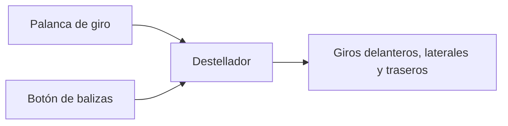

# D-6 · Sistema de luces de señal de giro y de advertencia de riesgo

Volver a [[Circuitos eléctricos]] · [[9A Sistemas de cableado]]

PDF: [[Manual de taller Swift 2005-2010.pdf#page=1327|diagrama original, página 1327]] (copia local)

> [!summary] Cómo funciona
> Giros y balizas: el destellador (relé de giros) alimenta los faros de giro, los repetidores y las calaveras.

**En el modelo 3D:** [faro_izq](https://xaguhz.github.io/vaultColegio/vaultSuzuki/3D/visor/index.html#faro_izq) · [faro_der](https://xaguhz.github.io/vaultColegio/vaultSuzuki/3D/visor/index.html#faro_der) · [calavera_izq](https://xaguhz.github.io/vaultColegio/vaultSuzuki/3D/visor/index.html#calavera_izq) · [calavera_der](https://xaguhz.github.io/vaultColegio/vaultSuzuki/3D/visor/index.html#calavera_der) · [casco](https://xaguhz.github.io/vaultColegio/vaultSuzuki/3D/visor/index.html#casco) · en el visor: **Circuitos → D-6**

**Fusibles:** `METER 10A`

**Conectores:** `E06` (Intermitente lateral (derecho)), `E09` (Intermitente delantero (derecho)), `E19` (Intermitente lateral (izquierdo)), `E20` (Intermitente delantero (izquierdo)), `E39` (J/B), `E42` (J/C), `E43` (J/C), `G11` (Interruptor de advertencia de riesgo), `G25` (Interruptor COMB), `G31` (J/C), `G33` (J/B), `G34` (J/B), `L05` (J/B), `L20` (Conjunto de luces traseras (R)), `L43` (Conjunto de luces traseras (L))

**Colores de cable:** `BLK`, `BLK/ORN`, `BLU/RED`, `BLU/YEL`, `GRN`, `GRN/RED`, `RED/BLU`, `RED/YEL`, `WHT`
