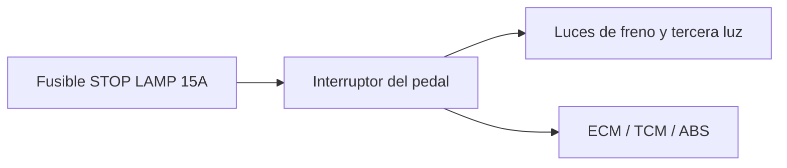

# D-7 · Sistema de las luces de freno

Volver a [[Circuitos eléctricos]] · [[9A Sistemas de cableado]]

PDF: [[Manual de taller Swift 2005-2010.pdf#page=1329|diagrama original, página 1329]] (copia local)

> [!summary] Cómo funciona
> Luces de freno: el interruptor del pedal alimenta las calaveras y la tercera luz; la señal también va al ECM, al TCM y al ABS.

**En el modelo 3D:** [interruptor_freno](https://xaguhz.github.io/vaultColegio/vaultSuzuki/3D/visor/index.html#interruptor_freno) · [calavera_izq](https://xaguhz.github.io/vaultColegio/vaultSuzuki/3D/visor/index.html#calavera_izq) · [calavera_der](https://xaguhz.github.io/vaultColegio/vaultSuzuki/3D/visor/index.html#calavera_der) · [porton](https://xaguhz.github.io/vaultColegio/vaultSuzuki/3D/visor/index.html#porton) · [abs](https://xaguhz.github.io/vaultColegio/vaultSuzuki/3D/visor/index.html#abs) · en el visor: **Circuitos → D-7**

**Fusibles:** `LAMP 15A`

**Conectores:** `E41` (J/B), `E47` (Interruptor de luces de freno), `L06` (J/B), `L08` (J/C), `L09` (J/C), `L17` (Tercera luz de freno), `L20` (Conjunto de luces traseras (R)), `L43` (Conjunto de luces traseras (L))

**Colores de cable:** `BLK`, `GRN/WHT`, `GRN/YEL`, `PNK`, `PNK/BLK`
