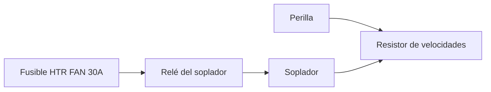

# E-1 · Sistema de calefacción

Volver a [[Circuitos eléctricos]] · [[9A Sistemas de cableado]]

PDF: [[Manual de taller Swift 2005-2010.pdf#page=1333|diagrama original, página 1333]] (copia local)

> [!summary] Cómo funciona
> Calefacción y ventilación: el soplador tiene un resistor de velocidades; las compuertas se mueven con cables o motores.

**En el modelo 3D:** [unidad_hvac](https://xaguhz.github.io/vaultColegio/vaultSuzuki/3D/visor/index.html#unidad_hvac) · [tablero](https://xaguhz.github.io/vaultColegio/vaultSuzuki/3D/visor/index.html#tablero) · [fusibles](https://xaguhz.github.io/vaultColegio/vaultSuzuki/3D/visor/index.html#fusibles) · en el visor: **Circuitos → E-1**

**Fusibles:** `BACK 10A`, `FAN 30A`, `SIG 10A`

**Conectores:** `E39` (J/B), `G01` (Actuador de recirculación / aire fresco), `G05` (Motor del ventilador del soplador), `G06` (Resistor del calefactor), `G15` (J/C), `G18` (Interruptor de control del modo), `G19` (Interruptor del ventilador de calefactor), `G31` (J/C), `G32` (J/B), `G34` (J/B)

**Colores de cable:** `BLK`, `BLK/ORN`, `BLK/RED`, `BLK/WHT`, `BLK/YEL`, `BLU`, `BLU/WHT`, `BRN`, `BRN/WHT`, `GRN`, `GRN/WHT`, `RED`, `RED/BLK`, `RED/YEL`, `YEL`
