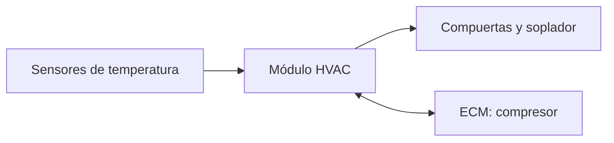

# E-2 · Sistema de A/C automático

Volver a [[Circuitos eléctricos]] · [[9A Sistemas de cableado]]

PDF: [[Manual de taller Swift 2005-2010.pdf#page=1335|diagrama original, página 1335]] (copia local)

> [!summary] Cómo funciona
> Aire acondicionado automático (otras versiones): módulo HVAC con sensores de temperatura y motores de compuertas.

**En el modelo 3D:** [unidad_hvac](https://xaguhz.github.io/vaultColegio/vaultSuzuki/3D/visor/index.html#unidad_hvac) · [ecu](https://xaguhz.github.io/vaultColegio/vaultSuzuki/3D/visor/index.html#ecu) · en el visor: **Circuitos → E-2**

**Fusibles:** `BACK 10A`, `FAN 30A`, `SIG 10A`

**Conectores:** `E39` (J/B), `G01` (Actuador de recirculación / aire fresco), `G05` (Motor del ventilador del soplador), `G09` (Termistor EVAP), `G15` (J/C), `G16` (J/C), `G17` (J/C), `G31` (J/C), `G32` (J/B), `G33` (J/B), `G34` (J/B), `G46` (Controlador del ventilador), `G47` (Diodo), `G48` (Actuador de control de temperatura), `G49` (Actuador de selección de modo), `G50` (Sensor de temperatura del habitáculo), `G51` (Unidad de A/C automático), `G52` (Unidad de A/C automático), `G53` (Sensor de luz solar)

**Colores de cable:** `BLK`, `BLK/ORN`, `BLK/WHT`, `BLK/YEL`, `BLU`, `BLU/RED`, `BLU/WHT`, `GRN`, `GRN/WHT`, `GRY`, `PNK`, `PNK/BLK`, `PPL/WHT`, `RED`, `RED/BLK`, `RED/YEL`, `WHT`, `WHT/BLK`, `WHT/BLU`, `WHT/RED`, `YEL`, `YEL/BLK`
