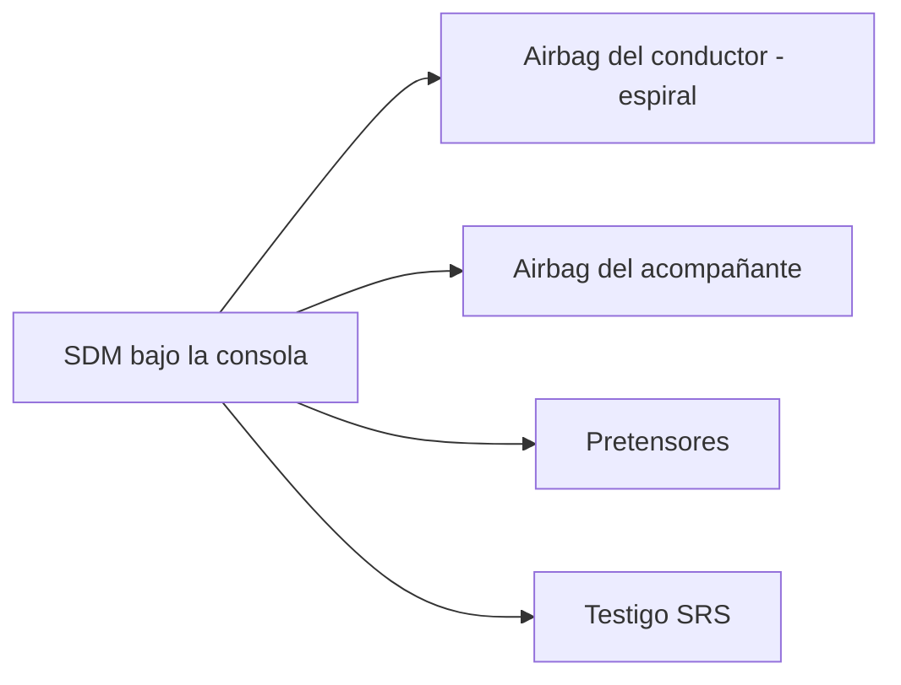

# F-1 · Sistema del airbag

Volver a [[Circuitos eléctricos]] · [[9A Sistemas de cableado]]

PDF: [[Manual de taller Swift 2005-2010.pdf#page=1337|diagrama original, página 1337]] (copia local)

> [!summary] Cómo funciona
> Airbags: el SDM (con su sensor de impacto) dispara los airbags del conductor y del acompañante y los pretensores; el testigo SRS avisa fallas.

**En el modelo 3D:** [sdm](https://xaguhz.github.io/vaultColegio/vaultSuzuki/3D/visor/index.html#sdm) · [volante](https://xaguhz.github.io/vaultColegio/vaultSuzuki/3D/visor/index.html#volante) · [airbag_acompanante](https://xaguhz.github.io/vaultColegio/vaultSuzuki/3D/visor/index.html#airbag_acompanante) · [pretensores](https://xaguhz.github.io/vaultColegio/vaultSuzuki/3D/visor/index.html#pretensores) · [cuadro_instrumentos](https://xaguhz.github.io/vaultColegio/vaultSuzuki/3D/visor/index.html#cuadro_instrumentos) · [mazo_tablero](https://xaguhz.github.io/vaultColegio/vaultSuzuki/3D/visor/index.html#mazo_tablero) · en el visor: **Circuitos → F-1**

**Fusibles:** `A/BAG 15A`

**Conectores:** `E13` (Sensor delantero), `E44` (Mazo de cables del suelo (a L03)), `G04` (Mazo de cables del suelo (a L32)), `G10` (Inflador del pasajero), `G26` (Inflador del conductor), `G34` (J/B), `L03` (Mazo de cables principal (a E45)), `L04` (J/B), `L10` (Pretensor (lado del conductor)), `L11` (L35/N), `L18` (Airbag de cortina lateral (R)), `L25` (vehículo), `L29` (A/B SDM), `L30`, `L32`, `L35`, `L36` (Pretensor (lado del pasajero)), `L41` (Airbag de cortina lateral (L)), `L53` (Conector de diagnóstico #3)

**Colores de cable:** `BLK`, `BLU/ORN`, `BLU/RED`, `BLU/YEL`, `BRN`, `BRN/WHT`, `GRN`, `GRN/RED`, `GRY`, `GRY/RED`, `LT GRN/BLK`, `ORN`, `PNK/BLK`, `PPL`, `PPL/WHT`, `RED`, `WHT/GRN`, `WHT/RED`, `YEL`, `YEL/BLK`, `YEL/RED`
