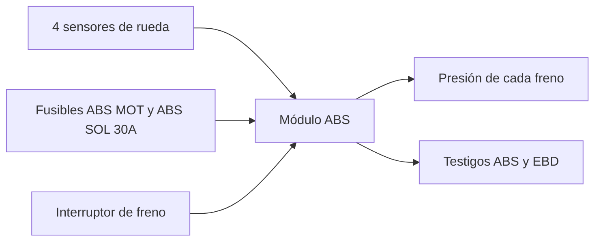

# F-2 · Sistema de frenos antibloqueo

Volver a [[Circuitos eléctricos]] · [[9A Sistemas de cableado]]

PDF: [[Manual de taller Swift 2005-2010.pdf#page=1339|diagrama original, página 1339]] (copia local)

> [!summary] Cómo funciona
> ABS: el módulo lee los cuatro sensores de rueda y la luz de freno y modula la presión de cada freno con su bomba y válvulas.

**En el modelo 3D:** [abs](https://xaguhz.github.io/vaultColegio/vaultSuzuki/3D/visor/index.html#abs) · [sensores_abs](https://xaguhz.github.io/vaultColegio/vaultSuzuki/3D/visor/index.html#sensores_abs) · [interruptor_freno](https://xaguhz.github.io/vaultColegio/vaultSuzuki/3D/visor/index.html#interruptor_freno) · [canerias_freno](https://xaguhz.github.io/vaultColegio/vaultSuzuki/3D/visor/index.html#canerias_freno) · [fusibles](https://xaguhz.github.io/vaultColegio/vaultSuzuki/3D/visor/index.html#fusibles) · en el visor: **Circuitos → F-2**

**Fusibles:** `ABS 10A`, `RADIO 15A`

**Conectores:** `C36` (Mazo de cables principal (a E24)), `E03` (Módulo de control del ABS), `E05` (E25/BLK), `E24` (Mazo de cables del motor (a C36)), `E25`, `E37`, `E38` (E45/N), `E41` (J/B), `E42` (J/C), `E43` (J/C), `E45`, `E46` (BCM), `E62`, `G15` (J/C), `G16` (J/C), `G17` (J/C), `G20` (DLC), `G33` (J/B), `G35` (Mazo de cables principal (a E37)), `G36` (Mazo de cables principal (a E38)), `G37` (BCM), `L02` (Mazo de cables principal (a E44)), `L14` (Sensor de velocidad de la rueda (RR)), `L38` (Sensor de velocidad de la rueda (RL))

**Colores de cable:** `BLK`, `BLK/ORN`, `BRN`, `GRN/ORN`, `GRN/WHT`, `LT GRN`, `LT GRN/BLK`, `PNK`, `PNK/BLK`, `PPL/WHT`, `RED`, `RED/BLK`, `RED/BLU`, `WHT`, `WHT/BLK`, `WHT/BLU`, `WHT/RED`, `YEL`
