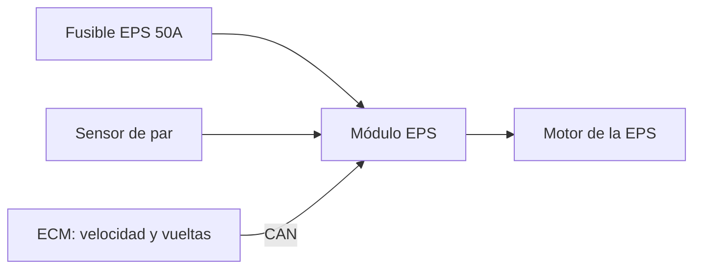

# F-3 · Sistema de la servodirección

Volver a [[Circuitos eléctricos]] · [[9A Sistemas de cableado]]

PDF: [[Manual de taller Swift 2005-2010.pdf#page=1341|diagrama original, página 1341]] (copia local)

> [!summary] Cómo funciona
> Dirección eléctrica: el módulo EPS lee el sensor de par de la columna y la velocidad del auto, y le pide más o menos fuerza al motor de asistencia.

**En el modelo 3D:** [modulo_eps](https://xaguhz.github.io/vaultColegio/vaultSuzuki/3D/visor/index.html#modulo_eps) · [columna_eps](https://xaguhz.github.io/vaultColegio/vaultSuzuki/3D/visor/index.html#columna_eps) · [cable_eps](https://xaguhz.github.io/vaultColegio/vaultSuzuki/3D/visor/index.html#cable_eps) · [ecu](https://xaguhz.github.io/vaultColegio/vaultSuzuki/3D/visor/index.html#ecu) · en el visor: **Circuitos → F-3**

**Fusibles:** `EPS 50A`, `J/B 10A`, `METER 10A`

**Conectores:** `C36` (Mazo de cables principal (a E24)), `E24` (Mazo de cables del motor (a C36)), `E37`, `E38` (E45/N), `E41` (J/B), `E42` (J/C), `E43` (J/C), `E46` (BCM), `E48` (Cable de la servodirección (a E50)), `E49` (Módulo de control de P/S), `E50` (Mazo de cables principal (a E48)), `E51` (Módulo de control de P/S), `E52` (Módulo de control de P/S), `E53` (Sensor de par de P/S), `E54` (Motor P/S), `E57`, `G15` (J/C), `G16` (J/C), `G17` (J/C), `G20` (DLC), `G28` (Medidor COMB), `G33` (J/B), `G35` (Mazo de cables principal (a E37)), `G36` (Mazo de cables principal (a E38)), `G37` (BCM)

**Colores de cable:** `BLK`, `BLK/ORN`, `BLU`, `BRN`, `GRN`, `GRY`, `LT GRN`, `LT GRN/BLK`, `PPL`, `PPL/WHT`, `RED`, `RED/BLK`, `RED/BLU`, `WHT`, `WHT/RED`, `YEL`
